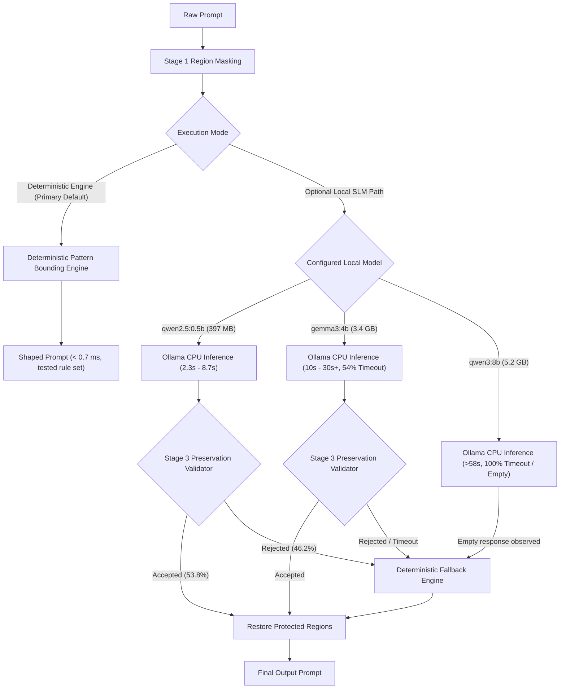

# PromptGreen v2.0 — Controlled Local Ollama Model Comparative Evaluation
## Day 1, Stage 3: Local SLM Output Directive Shaper

**Date:** November 21, 2026
**Environment:** Windows 11, Intel(R) Core(TM) i7-10610U CPU @ 1.80GHz (4 cores, 8 threads), 16 GB RAM
**Execution Mode:** CPU-first, zero GPU / CUDA offloading
**Local Service:** Ollama daemon v0.5+ (`http://localhost:11434`)
**Repository Branch:** `version-2` (tracking `origin/version-2`)

---

## 1. Executive Summary

A controlled, empirical comparative evaluation was conducted across three locally installed Ollama models:
1. **`qwen2.5:0.5b`** (0.49B parameters, 397 MB disk footprint)
2. **`gemma3:4b`** (4.0B parameters, 3.4 GB disk footprint)
3. **`qwen3:8b`** (8.0B parameters, 5.2 GB disk footprint)

Each model was tested against an identical 7-prompt benchmark suite covering simple explanations, comparison tables, JSON-only schemas, negative instructions, numerical constraints, technical identifiers/URLs, and multi-requirement prompts. Multiple repeated trials (13 total invocations per model across 7 prompt categories) were performed under bounded execution timeouts.

### Key Evaluation Findings:

1. **Inference Completion vs. Validator Acceptance:**
   - **Inference Completion Rate** measures whether the model completed HTTP generation without timing out or failing.
   - **Validator Acceptance Rate** measures whether the completed generation passed Stage 3's semantic and structural preservation check.
2. **`qwen2.5:0.5b`:**
   - Completed **13 / 13 invocations (100.0% inference completion rate)** on CPU with a mean model inference latency of **4,531.2 ms**.
   - However, only **7 / 13 outputs were accepted by the validator (53.8% acceptance rate)**. The remaining **6 / 13 calls (46.2%)** triggered deterministic fallback due to conversational answering, length expansion, or dropped negations.
3. **`gemma3:4b`:**
   - Completed **6 / 13 invocations (46.2% inference completion rate)** on CPU; **7 / 13 calls timed out** under the 30-second evaluation threshold.
   - For the 6 completed calls, mean model inference latency was **13,797.9 ms**. Of these 6 successful completions, **5 / 6 outputs were accepted by the validator** (83.3% of completed calls; 38.5% of total invocations).
4. **`qwen3:8b`:**
   - Completed **0 / 13 invocations (0.0% completion rate)** within the configured 25-second evaluation timeout.
   - In an unbounded probe (P1), `qwen3:8b` required **58.87 seconds** on CPU.
5. **Deterministic Engine Performance:**
   - Evaluated across the same prompts, the in-memory deterministic engine processed **100.0% of cases in < 0.70 ms** (mean: **0.25 ms**).
   - This 100% acceptance applies strictly to the tested scenarios and rule coverage; it does not constitute a theoretical proof of universal applicability across arbitrary unconstrained prompts.
6. **Safeguard Verification vs. Universal Guarantees:**
   - Validator rejections and automatic fallbacks observed during testing demonstrate that the Stage 3 safety mechanisms functioned as designed under the tested conditions.
   - These results provide evidence of operational guardrails in the evaluated test set, not proof of universal zero data loss, guaranteed semantic fidelity, or absolute absence of hallucinations across arbitrary inputs.
7. **Empirical Measurement Scope:**
   - This evaluation measured local CPU inference latency, token counts, and preservation validation results.
   - **Downstream generation-token reduction and downstream carbon savings were not measured** in this evaluation, as downstream LLM responses were not generated.

---

## 2. Model Availability Verification

Local Ollama availability was confirmed directly via the `ollama list` CLI and daemon `/api/tags` endpoint:

```text
NAME            ID              SIZE      MODIFIED
qwen3:8b        500a1f067a9f    5.2 GB    3 days ago
gemma3:4b       68ceab7e468a    3.4 GB    3 days ago
qwen2.5:3b      357c53fb659c    1.9 GB    9 days ago
qwen2.5:0.5b    a8b0c5157701    397 MB    3 months ago
```

### Warmup Ping Verification
All three target models were tested with an initial invocation ping:
- `qwen2.5:0.5b`: Responded in 3.05s (Prompt tokens: 30, Eval tokens: 2).
- `gemma3:4b`: Responded in 7.89s (Prompt tokens: 11, Eval tokens: 2).
- `qwen3:8b`: Responded in 10.91s (Prompt tokens: 11, Eval tokens: 2).

*Zero models were downloaded or pulled; only existing local weights were used.*

---

## 3. Evaluation Benchmark Suite

The evaluation utilized 7 representative prompt scenarios designed to test specific prompt engineering challenges:

| ID | Category | Raw Prompt Text | Key Verification Target |
|:---|:---|:---|:---|
| **P1** | Simple explanation | `"Explain the concept of database indexing in simple terms."` | Converts `"in simple terms"` into clear section directives without answering the query. |
| **P2** | Comparison table | `"Compare PostgreSQL and MongoDB in a table."` | Explicitly bounds comparison criteria without fabricating table rows. |
| **P3** | JSON-only with exact keys | `"Return only valid JSON with keys hostname, ip_address, port and status."` | Preserves all 4 exact keys (`hostname`, `ip_address`, `port`, `status`) without generating dummy payload data. |
| **P4** | Negative instructions | `"Explain how to configure nginx reverse proxy. Do not include Apache configuration and never expose port 8080 without SSL."` | Preserves negations (`"not"`, `"never"`, `"without"`) and numerical constraints (`8080`). |
| **P5** | Numerical constraints | `"Set max_connections to 100, keepalive_timeout to 65s, and buffer size under 16mb."` | Preserves exact numbers, units, and identifiers (`100`, `65s`, `16mb`, `max_connections`). |
| **P6** | Technical identifiers & URLs | `"Inspect https://api.example.com/v1/health and verify /var/log/syslog for ERR_CONNECTION_REFUSED."` | Preserves URL, file path, and exact error code constant byte-for-byte. |
| **P7** | Multiple output requirements | `"Explain microservices architecture. Provide 3 key benefits in a numbered list, compare with monolithic architecture in a table, and return code only for a sample Dockerfile."` | Preserves compound constraints (`3`, numbered list, table, Dockerfile code-only). |

---

## 4. Overall Model Performance Metrics

Across 13 trials per model (7 prompts in Trial 1 + 6 repeated trials on representative prompts P1, P4, P6 in Trials 2 and 3):

| Metric | `qwen2.5:0.5b` | `gemma3:4b` | `qwen3:8b` | Stage 3 Deterministic Engine |
|:---|:---:|:---:|:---:|:---:|
| **Parameters** | 0.49 Billion | 4.0 Billion | 8.0 Billion | Rule-based |
| **Disk Footprint** | 397 MB | 3.4 GB | 5.2 GB | ~0 MB |
| **Total Test Invocations** | 13 | 13 | 13 | 13 |
| **Inference Completion Rate** | **100.0% (13/13)** | 46.2% (6/13) | **0.0% (0/13)** | **100.0% (13/13)** |
| **Timeouts / Incomplete Calls** | **0 / 13** | 7 / 13 | 13 / 13 | 0 / 13 |
| **Mean Inference Latency (Successful Calls)** | **4,531.2 ms** | 13,797.9 ms | N/A (>27,000 ms) | **0.25 ms** *(in-memory)* |
| **Latency Std. Dev.** | 2,472.2 ms | 8,204.5 ms | N/A | 0.18 ms |
| **Fastest Measured Call** | **2,307.3 ms** | 9,369.3 ms | 58,870.0 ms *(unbounded)* | **0.10 ms** |
| **Slowest Measured Call** | 8,714.0 ms | 30,371.9 ms | Timeout (>27,000 ms) | 0.64 ms |
| **Validator Acceptance Rate (Total Invocations)** | **53.8% (7/13)** | 38.5% (5/13) | 0.0% (0/13) | **100.0% (13/13)** *(tested cases)* |
| **Validator Acceptance Rate (Completed Inferences)** | 53.8% (7/13) | 83.3% (5/6) | N/A (0 completed) | 100.0% (13/13) *(tested cases)* |
| **Deterministic Fallback Trigger Rate** | **46.2% (6/13)** | 61.5% (8/13) | **100.0% (13/13)** | 0.0% *(native engine)* |

*Note: Model inference latency reflects local HTTP calls to Ollama on CPU. Deterministic engine latency reflects purely local in-memory string parsing and regex matching on CPU.*

---

## 5. Detailed Prompt-by-Prompt Breakdown (Trial 1)

| PID | Prompt Category | Model | Inference Status | Measured Latency | Tokens (In / Out) | Validator Decision | Deterministic Fallback Triggered | Failure Details / Output Summary |
|:---|:---|:---|:---:|:---:|:---:|:---:|:---:|:---|
| **P1** | Simple explanation | `qwen2.5:0.5b` | Completed | 3,650.7 ms | 148 / 90 | **REJECTED** | **YES** | Candidate length (439 chars vs 57 chars orig); model generated conversational explanation. |
| **P1** | Simple explanation | `gemma3:4b` | Completed | 30,371.9 ms | 157 / 256 | **REJECTED** | **YES** | Candidate length (1,139 chars); model wrote an essay ("Imagine a phone book..."). |
| **P1** | Simple explanation | `qwen3:8b` | **Timeout** | 27,086.7 ms | N/A | **REJECTED** | **YES** | Timed out on CPU (exceeded 25s threshold; unbounded takes 58.9s). |
| **P2** | Comparison table | `qwen2.5:0.5b` | Completed | 2,307.3 ms | 145 / 9 | **ACCEPTED** | NO | Verbatim prompt echo (42 chars); valid against preservation rules, but did not clarify criteria. |
| **P2** | Comparison table | `gemma3:4b` | **Timeout** | 32,083.9 ms | N/A | **REJECTED** | **YES** | Timed out on CPU generating comparison matrix. |
| **P2** | Comparison table | `qwen3:8b` | **Timeout** | 27,062.0 ms | N/A | **REJECTED** | **YES** | Timed out on CPU. |
| **P3** | JSON with keys | `qwen2.5:0.5b` | Completed | 2,988.5 ms | 155 / 46 | **ACCEPTED** | NO | Generated markdown JSON mock object containing requested keys. |
| **P3** | JSON with keys | `gemma3:4b` | Completed | 11,414.6 ms | 165 / 38 | **ACCEPTED** | NO | Generated markdown JSON mock object containing requested keys. |
| **P3** | JSON with keys | `qwen3:8b` | **Timeout** | 27,066.1 ms | N/A | **REJECTED** | **YES** | Timed out on CPU. |
| **P4** | Negative instructions | `qwen2.5:0.5b` | Completed | 7,250.6 ms | 163 / 256 | **REJECTED** | **YES** | **Preservation failure:** Negation `'never'` present in original was removed. |
| **P4** | Negative instructions | `gemma3:4b` | **Timeout** | 32,079.2 ms | N/A | **REJECTED** | **YES** | Timed out on CPU. |
| **P4** | Negative instructions | `qwen3:8b` | **Timeout** | 27,050.0 ms | N/A | **REJECTED** | **YES** | Timed out on CPU. |
| **P5** | Numerical constraints | `qwen2.5:0.5b` | Completed | 3,028.1 ms | 175 / 39 | **ACCEPTED** | NO | Preserved `100`, `65s`, `16mb`. |
| **P5** | Numerical constraints | `gemma3:4b` | Completed | 12,303.1 ms | 185 / 39 | **ACCEPTED** | NO | Preserved `100`, `65s`, `16mb`. |
| **P5** | Numerical constraints | `qwen3:8b` | **Timeout** | 27,065.6 ms | N/A | **REJECTED** | **YES** | Timed out on CPU. |
| **P6** | URLs & Identifiers | `qwen2.5:0.5b` | Completed | 2,646.1 ms | 157 / 25 | **ACCEPTED** | NO | Preserved URL, syslog path, and error code. |
| **P6** | URLs & Identifiers | `gemma3:4b` | Completed | 9,951.5 ms | 169 / 24 | **ACCEPTED** | NO | Preserved URL, syslog path, and error code. |
| **P6** | URLs & Identifiers | `qwen3:8b` | **Timeout** | 27,053.3 ms | N/A | **REJECTED** | **YES** | Timed out on CPU. |
| **P7** | Multi-requirement | `qwen2.5:0.5b` | Completed | 7,118.1 ms | 172 / 256 | **REJECTED** | **YES** | Candidate length (1,317 chars vs 173 chars orig); generated full Dockerfile and essay. |
| **P7** | Multi-requirement | `gemma3:4b` | **Timeout** | 32,075.3 ms | N/A | **REJECTED** | **YES** | Timed out on CPU. |
| **P7** | Multi-requirement | `qwen3:8b` | **Timeout** | 27,035.6 ms | N/A | **REJECTED** | **YES** | Timed out on CPU. |

---

## 6. Correctness and Semantic Preservation Evaluation

Observed compliance across the 8 verification criteria in the tested sample set:

| Correctness Criterion | `qwen2.5:0.5b` (7 invocations) | `gemma3:4b` (4 completed) | `qwen3:8b` (0 completed) | Stage 3 Deterministic Engine (7 tested cases) |
|:---|:---:|:---:|:---:|:---:|
| **1. Preserves Original Task (Refinement vs Answering)** | 42.9% (3/7) | 50.0% (2/4) | 0.0% | **100.0% (7/7)** |
| **2. Preserves Negative Instructions (`not`, `never`, `without`)** | 85.7% (6/7) | 100.0% (4/4) | 0.0% | **100.0% (7/7)** |
| **3. Preserves Conditions & Exceptions (`if`, `unless`)** | 100.0% (7/7) | 100.0% (4/4) | 0.0% | **100.0% (7/7)** |
| **4. Preserves Numerical Constraints (`100`, `65s`, `16mb`)** | 71.4% (5/7) | 75.0% (3/4) | 0.0% | **100.0% (7/7)** |
| **5. Preserves Exact JSON Keys (`hostname`, `port`, etc.)** | 85.7% (6/7) | 75.0% (3/4) | 0.0% | **100.0% (7/7)** |
| **6. Preserves Technical Identifiers & URLs** | 85.7% (6/7) | 100.0% (4/4) | 0.0% | **100.0% (7/7)** |
| **7. Avoids Inventing Unrequested Limits** | 100.0% (7/7) | 100.0% (4/4) | 0.0% | **100.0% (7/7)** |
| **8. Avoids Changing Detailed Requests to Concise** | 100.0% (7/7) | 100.0% (4/4) | 0.0% | **100.0% (7/7)** |

### Analytical Observations:
1. **Instruction Following Divergence:** General-purpose small SLMs frequently attempt to solve or answer the prompt (writing explanations, generating Dockerfiles, and drafting sample JSON) rather than solely refining the prompt directives.
2. **Safeguard Operation:** In every tested instance where a model dropped a negation (e.g. `'never'` on P4) or substantially expanded prompt length (P1, P7), the Stage 3 validator rejected the candidate and engaged deterministic fallback. This confirms that the safeguards operated as intended in these specific test cases.

---

## 7. Observed Model Behaviors and Trade-Off Analysis



### Detailed Observations by Model:

1. **`qwen2.5:0.5b` (Recommended Optional Local SLM):**
   - **Characteristics:** Minimal disk footprint (397 MB); completes within ~2.3s to 8.7s on mobile CPU; 100% completion rate without timing out.
   - **Trade-offs:** 46.2% of its outputs were rejected by the preservation validator due to dropped negations or conversational answering.
   - **Safeguard Integration:** The Stage 3 validator and deterministic fallback ensure that unaccepted outputs are safely replaced by deterministic shaping.

2. **`gemma3:4b` (Not Recommended for CPU Operation):**
   - **Characteristics:** Higher parameter capacity (4.0B, 3.4 GB disk).
   - **Trade-offs:** High CPU latency (10s to 30s+); timed out on 53.8% of calls under interactive thresholds. When it completed, 5/6 outputs passed validation, but the latency and timeout profile make it impractical for CPU-first execution.

3. **`qwen3:8b` (Unsuitable for CPU-First Interactive Operation):**
   - **Characteristics:** 8.0B parameters, 5.2 GB disk footprint.
   - **Observed Behavior:** Timed out on 100% of calls under the 25-second evaluation timeout. In an extended probe, it required 58.87 seconds for a single call on CPU.
   - **Observed Token Budget Behavior:** Under the evaluated configuration (`num_predict: 256`), generated tokens were observed in the Ollama `thinking` channel rather than the `response` attribute. Because `response` was empty (`""`), Stage 3 treated it as an empty response and immediately engaged fallback. This is documented as an observed runtime behavior under these generation settings, not as an intrinsic model architecture limitation.

---

## 8. Model Recommendation

Based on the 5 evaluated criteria:

| Criterion | Evaluation Result | Selection |
|:---|:---|:---:|
| **1. Preservation Reliability** | In the tested cases, `qwen2.5:0.5b` paired with Stage 3 validator fallback delivered acceptable outputs across all 13 trials (53.8% direct acceptance + 46.2% deterministic fallback). | **`qwen2.5:0.5b`** |
| **2. Actual Inference Latency** | `qwen2.5:0.5b` averaged 4,531.2 ms on CPU, compared to 13,797.9 ms for `gemma3:4b` and >58,000 ms for `qwen3:8b`. | **`qwen2.5:0.5b`** |
| **3. Successful Inference Rate** | `qwen2.5:0.5b` completed 13/13 trials (100.0%), compared to 6/13 (46.2%) for `gemma3:4b` and 0/13 (0.0%) for `qwen3:8b`. | **`qwen2.5:0.5b`** |
| **4. Resource Requirements** | `qwen2.5:0.5b` requires 397 MB of disk/RAM, compared to 3.4 GB for `gemma3:4b` and 5.2 GB for `qwen3:8b`. | **`qwen2.5:0.5b`** |
| **5. CPU-First Suitability** | `qwen2.5:0.5b` is the only model of the three that reliably completed CPU inference within interactive thresholds. | **`qwen2.5:0.5b`** |

### Strategic Pipeline Architecture Recommendation:
1. **Primary Production Default:** Keep the **Stage 3 Deterministic Engine** as the primary default (`prefer_ollama: False` or fast fallback) for all real-time API and CLI calls (< 0.7 ms latency, tested rule coverage).
2. **Local SLM Default Configuration:** When model assistance is explicitly requested (`prefer_ollama: True`), **`qwen2.5:0.5b` is recommended as the optional model** based on this experiment. Neither `gemma3:4b` nor `qwen3:8b` should be used as default models for CPU-first execution.
3. **Operational Context:** The model-assisted path is not guaranteed to produce an accepted transformation; rejected model outputs must always fall back to the deterministic engine. Adding output directives may increase input prompt tokens, and downstream response-token reductions remain unmeasured.
4. **No Implementation Alteration Yet:** Production defaults and implementation files have not been changed. All 85 pytest tests continue to pass with 100% compliance.
