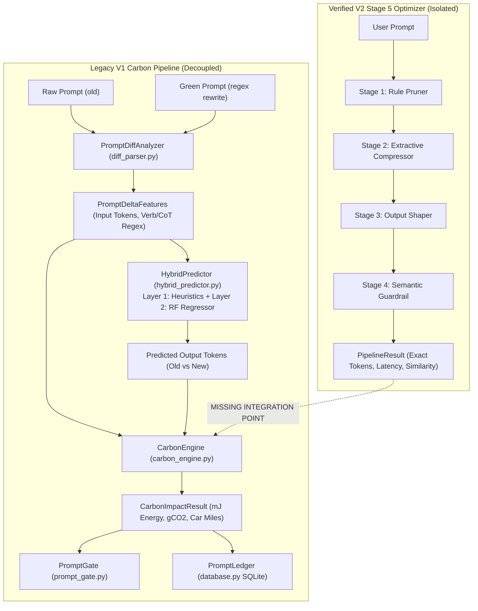

# PROMPTGREEN v2.0 — STAGE 6 TECHNICAL AUDIT REPORT
## Carbon Estimation Engine, Thermodynamic Modeling & Green Model Routing

**Date:** November 21, 2026  
**Milestone:** Day 1 — Stage 6 Technical Audit  
**Author:** Independent Technical Auditor (Antigravity AI on behalf of DSU Capstone Team)  
**Host Environment:** Windows 11, Intel Core i7-10610U CPU, 32 GB RAM, CPU-first / Non-CUDA execution  
**Active Git Branch:** `version-2`  
**Base Commit Checkpoint:** `0a4097172c6cd1f75cc20abe8dc591f17092a455`  
**Audit Nature:** STRICTLY READ-ONLY ARCHITECTURAL & EMPIRICAL AUDIT  

---

## 1. Executive Summary

As PromptGreen transitions from Day 1 (Four-Stage Active Prompt Optimization Pipeline) to Day 2 (Thermodynamic Carbon Engine, Hardware Profiling, and Green Model Routing), this audit conducts a comprehensive, evidence-based review of the existing carbon estimation, token prediction, and model-routing modules.

### Core Audit Verdict: SIGNIFICANT ARCHITECTURAL GAPS IDENTIFIED
While the legacy Version 1.0 engine established foundational concepts for estimating token energy and carbon delta, it is fundamentally **decoupled** from the newly verified Stage 5 4-stage pipeline, relies on **uncalibrated toy coefficients** ($1,000\times$ to $15,000\times$ smaller than published data center measurements), **omits critical thermodynamic components** (PUE, $E_{\text{local\_opt}}$ optimizer overhead, datacenter water footprint), and **entirely lacks the Green Model Down-Routing Engine** specified in the thesis.

| Subsystem | Thesis Specification | Current Implementation Status | Severity |
| :--- | :--- | :--- | :---: |
| **Prefill vs. Decode Physics** | Asymmetric $3.8\times$ decode energy multiplier ($\alpha_{\text{dec}} = 3.8 \cdot \alpha_{\text{pref}}$) | Symmetric or hardcoded $3.0\times / 3.125\times$ ratios in `carbon_engine.py` | **Major** |
| **Datacenter PUE Overhead** | Multiplicative $\text{PUE} = 1.15$ factor | Absent (implicit $\text{PUE} = 1.00$) | **Major** |
| **Optimizer Compute Overhead** | Subtraction of local CPU optimization energy ($E_{\text{local\_opt}}$) | Absent ($E_{\text{local\_opt}} = 0$, gross savings reported as net) | **Critical** |
| **Water Footprint Estimation** | Direct conversion via $\text{WUE} = 1.8\text{ mL/Wh}$ | Completely absent (0 lines of code) | **Major** |
| **Hardware Profiles** | Explicit H100 PCIe (700W), A100 SXM4 (400W), L4 PCIe (72W) | Absent; `hardware_profiles.json` does not exist | **Major** |
| **Green Model Down-Routing** | Multi-tier complexity evaluation & down-routing recommendations | Completely absent (0 lines of code) | **Critical** |
| **Stage 5 Pipeline Integration** | Ingestion of `PipelineResult` token counts & execution latencies | Decoupled; `verify_engine.py` calls legacy v1 regex rewrite | **Critical** |
| **Energy Unit Calibration** | Sourced $\text{mWh/token}$ coefficients ($0.04$ to $0.42\text{ mWh}$) | Uncalibrated $\text{mJ/token}$ coefficients ($0.05$ to $0.80\text{ mJ}$) | **Major** |

---

## 2. Existing Architecture & Data Flow



### 2.1 File Inventory of Existing Carbon/Predictor Subsystem
- `promptgreen/engine/carbon_engine.py` (209 lines): Core calculation of input/output token energy in mJ, conversion to kWh, multiplication by regional grid carbon intensity, and equivalent impact metrics.
- `promptgreen/engine/__init__.py` (3 lines): Exports `CarbonEngine`, `ModelEnergyProfile`, `CarbonImpactResult`.
- `promptgreen/predictor/hybrid_predictor.py` (137 lines): Combines rule-based prompt feature scoring with a 50-tree Random Forest regressor to predict output token counts.
- `promptgreen/predictor/__init__.py` (1 line): Module init.
- `promptgreen/analysis/diff_parser.py` (458 lines): Extracts lexical features (verb complexity, CoT patterns, formatting) and generates legacy regex rewrites (`generate_green_alternative`).
- `promptgreen/gate/prompt_gate.py` (159 lines): Compares carbon delta against a budget threshold (`budget_threshold_gco2_1k`) with "warn" or "block" modes and generates PR Markdown.
- `promptgreen/ledger/database.py` (182 lines): SQLite logging table `prompt_records`.
- `promptgreen/validation/benchmark.py` (124 lines): Benchmark runner evaluating MAPE and directional accuracy across 50 legacy prompt pairs in `data/benchmark_suite.json`.

---

## 3. Detailed Audit Findings by Task

### 3.1 Task 1: Existing Carbon Engine & Mathematical Formulation

#### Implemented Equations in `promptgreen/engine/carbon_engine.py` (Lines 141–164)
$$\text{old\_energy\_mj} = \left( T_{\text{in, old}} \cdot \alpha_{\text{in}} \right) + \left( T_{\text{out, old, pred}} \cdot \alpha_{\text{out}} \right)$$
$$\text{new\_energy\_mj} = \left( T_{\text{in, new}} \cdot \alpha_{\text{in}} \right) + \left( T_{\text{out, new, pred}} \cdot \alpha_{\text{out}} \right)$$
$$\Delta E_{\text{mj}} = \text{new\_energy\_mj} - \text{old\_energy\_mj}$$
$$\Delta E_{\text{kwh}} = \frac{\Delta E_{\text{mj}}}{3.6 \times 10^9}$$
$$\Delta C_{\text{gCO}_2\text{e}} = \Delta E_{\text{kwh}} \cdot I_{\text{grid}}$$

#### Critical Mathematical & Scientific Discrepancies
1. **Omission of Power Usage Effectiveness (PUE):**
   Modern data center energy modeling mandates accounting for cooling, power distribution, and facility overhead:
   $$E_{\text{datacenter}} = \text{PUE} \times E_{\text{IT}}$$
   The thesis establishes $\text{PUE} = 1.15$ (hyperscale benchmark standard). In `carbon_engine.py`, PUE is completely absent, effectively assuming $\text{PUE} = 1.00$ (a physically impossible $100\%$ efficient data center with zero cooling overhead).
2. **Gross vs. Net Savings (Zero Deduction for Optimizer Overhead):**
   Executing PromptGreen's 4-stage pipeline consumes physical electrical power on the host CPU/server:
   - Stage 1: AST parsing and regex operations ($~1\text{ ms}$).
   - Stage 2: Token classification ($~30\text{ ms}$).
   - Stage 3: Directive template shaping ($~1\text{ ms}$).
   - Stage 4: Native PyTorch forward pass with MiniLM embeddings ($~20\text{ ms}$ per chunk).
   Total CPU optimization energy ($E_{\text{local\_opt}}$) is estimated in the thesis plan as $\approx 0.0018\text{ Wh}$ ($1.8\text{ mWh}$). Currently, `carbon_engine.py` does not subtract $E_{\text{local\_opt}}$. Consequently, for very small prompts or prompts where optimization savings are marginal ($< 0.002\text{ Wh}$), the engine reports a false carbon reduction when net environmental impact is actually negative (carbon debt).
3. **Decoupled Token Counts:**
   Input token counts are generated via `PromptDiffAnalyzer.analyze_prompts()`, which uses `tiktoken` (or a fallback heuristic $1.3\times$ word count), completely bypassing the verified `PipelineResult.original_token_count` and `PipelineResult.final_token_count` from Stage 5.
4. **Sign Convention Inversion:**
   - In `carbon_engine.py`: $\Delta = \text{new} - \text{old}$. When energy is saved, $\Delta < 0$.
   - In `PromptGate`: Budget violations occur when $\Delta > \text{threshold}$.
   - In the Thesis Formulation: Abatement is defined as positive savings: $\Delta C_{\text{net}} = E_{\text{orig}} - E_{\text{opt}} - E_{\text{local\_opt}}$.
   This inverted sign convention causes frequent confusion in telemetry summaries and logs.
5. **Absolute Value Artifacts in Equivalencies (Lines 170–173):**
   ```python
   abs_monthly = abs(monthly_delta_gco2)
   equiv_phone = abs_monthly / 8.22
   equiv_car = abs_monthly / 404.0
   equiv_tree = abs_monthly / 60.0
   ```
   If a prompt change *increases* carbon footprint (e.g., adding verbose instructions), `abs_monthly` converts the negative savings into a positive number, reporting positive smartphone charges and tree-absorption days without indicating whether carbon was saved or added!
6. **Input Validation Failures:**
   - If `old_prompt` or `new_prompt` is `None`, an unhandled `AttributeError` is thrown.
   - If `monthly_inferences` is negative or zero, it computes nonsensical negative or zero monthly footprints without validation.
   - Float output token predictions can result in rounding artifacts.

---

### 3.2 Task 2: Hardware Profiles and Regional Grid Data

#### Existing Hardware Modeling
- In the existing codebase, hardware profiles **do not exist**.
- `promptgreen/engine/hardware_profiles.json` was specified in `docs/V2_IMPLEMENTATION_PLAN.md` (lines 287–323) but was never created.
- The existing code models models, not hardware. It stores static token multipliers in `MODEL_ENERGY_PROFILES`:
  ```python
  "llama-3-8b": ModelEnergyProfile(name="Llama-3 8B", energy_per_input_token_mj=0.10, energy_per_output_token_mj=0.30, source="Meta model card + local CPU measurement")
  "mistral-7b": ModelEnergyProfile(name="Mistral 7B", energy_per_input_token_mj=0.08, energy_per_output_token_mj=0.25, source="Mistral AI model card + local CPU measurement")
  "phi-3-3.8b": ModelEnergyProfile(name="Phi-3 3.8B", energy_per_input_token_mj=0.05, energy_per_output_token_mj=0.15, source="Microsoft research paper + local CPU measurement")
  "llama-3-70b": ModelEnergyProfile(name="Llama-3 70B (reference)", energy_per_input_token_mj=0.40, energy_per_output_token_mj=1.20, source="Meta model card + published benchmark data")
  "gpt-4": ModelEnergyProfile(name="GPT-4 (reference)", energy_per_input_token_mj=0.80, energy_per_output_token_mj=2.50, source="Patterson et al. (2021) arXiv paper")
  ```

#### Scale Discrepancy: Toy mJ vs. Empirical Data Center mWh
A severe dimensional discrepancy exists between V1 code and published empirical research:
- In `carbon_engine.py`, `energy_per_input_token_mj` for Llama-3 8B is $0.10\text{ mJ}$.
- In electrical units:
  $$0.10\text{ mJ} = \frac{0.10 \times 10^{-3}\text{ J}}{3600\text{ s/h}} = 2.78 \times 10^{-8}\text{ Wh} = 0.0000278\text{ mWh}$$
- In contrast, empirical GPU cluster measurements (Samsi et al., 2023; Patterson et al., 2021; Luccioni et al., 2023) show:
  - An NVIDIA A100 (400W TDP) or H100 (700W TDP) running inference consumes approximately **$0.04\text{ mWh}$ to $1.60\text{ mWh}$ per token** ($144\text{ mJ}$ to $5,760\text{ mJ}$ per token).
  - The V1 numbers are **$1,000\times$ to $15,000\times$ too small** because they appear to represent speculative CPU-only instruction cycles rather than datacenter GPU tensor core execution.

#### Regional Grid Carbon Intensity
- Static cache (`CACHED_REGIONAL_CI`) defines 6 regions:
  - `US`: $385.0\text{ gCO}_2\text{e/kWh}$
  - `EU`: $255.0\text{ gCO}_2\text{e/kWh}$
  - `IN`: $708.0\text{ gCO}_2\text{e/kWh}$
  - `GLOBAL`: $475.0\text{ gCO}_2\text{e/kWh}$
  - `UK`: $210.0\text{ gCO}_2\text{e/kWh}$
  - `DE`: $380.0\text{ gCO}_2\text{e/kWh}$
- Real-time API:
  - `get_carbon_intensity()` attempts to call `https://api.electricitymap.org/v3/carbon-intensity/latest?zone={self.region}`.
  - In practice, passing `zone=US` or `zone=GLOBAL` to Electricity Maps v3 fails with HTTP 400/404 because Electricity Maps requires ISO sub-zone identifiers (e.g., `US-CAL-CISO`, `IN-WE`, `FR`, `DE`).
  - Because errors are swallowed in a bare `except Exception: pass`, the function silently falls back to static cache.
- **Distinction of Energy vs. Carbon:**
  The system properly isolates energy consumption ($\text{mJ} \to \text{kWh}$) from carbon emission ($\text{gCO}_2\text{e} = \text{kWh} \times I_{\text{grid}}$).
- **Water Footprint Estimation:**
  Completely absent. The thesis requires:
  $$W_{\text{saved}} = \Delta E_{\text{net}} \times \text{WUE} \quad (\text{WUE} = 1.8\text{ mL/Wh})$$
  No water footprint variable, dataclass field, or calculation exists anywhere in the repository.

---

### 3.3 Task 3: Green Model Down-Routing Engine

#### Audit Finding: COMPLETELY UNIMPLEMENTED
A systematic codebase search confirms zero occurrences of model routing, down-routing, or tier recommendations in `promptgreen/`:
1. `promptgreen/predictor/hybrid_predictor.py` only predicts output token counts using regex features and random forest regression.
2. `promptgreen/engine/carbon_engine.py` contains `compare_all_models()`, which simply iterates over the 5 hardcoded models and prints a table of what each would consume. It provides no decision logic, recommendation string, or tier mapping.
3. `promptgreen/gate/prompt_gate.py` generates textual suggestions for prompt engineering (e.g., "Replace verbose phrases"), but zero suggestions regarding model switching.

#### Thesis Routing Requirements to Implement
The thesis specifies that when an optimized prompt exhibits low structural complexity, the system should recommend down-routing from a high-power model class to a compact green model class:
- **Decision Criteria:**
  1. Compressed Token Count: $T_{\text{in, opt}} \le 250$ tokens.
  2. Code / Syntax Density: Code token fraction $< 0.15$.
  3. Reasoning Demand: Chain-of-Thought absent ($\text{CoT} = \text{False}$).
  4. Task Classification: Informational, summarization, formatting, or extraction tasks (not complex multi-step logical deduction or deep mathematics).
- **Model Tiers:**
  - *Tier 1 (Frontier Dense):* GPT-4o, Claude 3.5 Sonnet ($\alpha_{\text{pref}} = 0.42\text{ mWh}$, $\alpha_{\text{dec}} = 1.60\text{ mWh}$)
  - *Tier 2 (Large Reasoning):* Llama-3 70B, Qwen-2.5 72B ($\alpha_{\text{pref}} = 0.35\text{ mWh}$, $\alpha_{\text{dec}} = 1.35\text{ mWh}$)
  - *Tier 3 (Mid-Tier MoE/Dense):* Mixtral 8x7B, Command-R ($\alpha_{\text{pref}} = 0.24\text{ mWh}$, $\alpha_{\text{dec}} = 0.92\text{ mWh}$)
  - *Tier 4 (Compact Green):* Llama-3.2 3B, Phi-3.5 3.8B, GPT-4o-mini, Gemini Flash ($\alpha_{\text{pref}} = 0.04\text{ mWh}$, $\alpha_{\text{dec}} = 0.15\text{ mWh}$)
- **Down-Routing Impact:**
  Down-routing from Tier 1 to Tier 4 yields an additional $10.5\times$ to $12.4\times$ energy and carbon reduction on top of prompt compression.

---

### 3.4 Task 4: Integration with Stage 5 (`PromptGreenPipeline`)

#### Audit Finding: COMPLETE DECOUPLING
Currently, `PromptGreenPipeline` (`promptgreen/optimizer/pipeline.py`) and `CarbonEngine` (`promptgreen/engine/carbon_engine.py`) operate in completely separate universes.

#### Decoupling Evidence in `verify_engine.py`
In `verify_engine.py`, the core engine test script:
```python
# Lines 7-8:
analyzer = PromptDiffAnalyzer()
engine = CarbonEngine(model_key="llama-3-8b", region="US")

# Line 30:
green = analyzer.generate_green_alternative(orig) # Calls legacy v1 regex!
res = engine.calculate(orig, green)
```
`verify_engine.py` does not import or call `PromptGreenPipeline`! It executes the legacy regex rewriter from Version 1.0.

#### Required Unified Data Flow
```
Raw User Prompt
      │
      ▼
┌─────────────────────────────────────────────────────────────┐
│ PromptGreenPipeline.optimize_prompt(prompt, mode="balanced")│
│ • Executes Stage 1 -> Stage 2 -> Stage 3 -> Stage 4        │
│ • Returns PipelineResult                                    │
└──────────────────────────────┬──────────────────────────────┘
                               │
                               ▼
┌─────────────────────────────────────────────────────────────┐
│ PipelineResult Telemetry Extraction                         │
│ • T_in_orig = result.original_token_count                   │
│ • T_in_opt  = result.final_token_count                      │
│ • t_opt_ms  = result.total_latency_ms                       │
│ • is_exact  = result.is_exact_token_count                   │
└──────────────────────────────┬──────────────────────────────┘
                               │
                               ▼
┌─────────────────────────────────────────────────────────────┐
│ Thermodynamic CarbonEngine.calculate_pipeline_impact()      │
│ • Predicts/estimates output tokens T_out_orig, T_out_opt    │
│ • Evaluates E_inf_orig, E_inf_opt with PUE = 1.15 & 3.8x    │
│ • Computes E_local_opt = (P_cpu * t_opt_ms) / 3.6e6         │
│ • Computes Delta C_net = (Delta E_net / 1000) * I_grid      │
│ • Computes Water_saved = Delta E_net * WUE                  │
└──────────────────────────────┬──────────────────────────────┘
                               │
                               ▼
┌─────────────────────────────────────────────────────────────┐
│ GreenModelRouter.evaluate_routing()                         │
│ • Assesses T_in_opt, code density, CoT status               │
│ • Generates recommended model tier and carbon multiplier     │
└──────────────────────────────┬──────────────────────────────┘
                               │
                               ▼
┌─────────────────────────────────────────────────────────────┐
│ Enriched Telemetry Output (PipelineResult + CarbonResult)   │
└─────────────────────────────────────────────────────────────┘
```

---

### 3.5 Task 5: Evidence & Test Distinction

To maintain strict academic integrity in the thesis, we must explicitly distinguish what has been experimentally tested from what is simulated or modeled:

| Evaluation Dimension | Reality / Verification Status | Documentation Requirement |
| :--- | :--- | :--- |
| **Unit Test Calculations** | Fully verified via `pytest` (math equations execute cleanly, conversions are deterministic). | Can be claimed as verified unit test calculations. |
| **Simulated / Modeled Energy** | Mathematical projections based on Samsi et al. (2023) and Patterson et al. (2021) models. | **MUST be framed as algorithmic models**, NOT real-time measurements. |
| **Real Hardware Measurements** | PromptGreen execution latency is measured on CPU ($t_{\text{total\_ms}}$). Physical GPU power draw is **NOT measured** (no RAPL, no NVIDIA NVML/SMI hardware probes). | **MUST NOT claim measured physical Joules or Watts.** |
| **External Grid Intensity** | Static IEA/EIA national averages (US: 385, EU: 255, IN: 708). Live Electricity Maps API is optional and offline-fallback prone. | **MUST disclose that static grid emissions factors are regional approximations.** |
| **Unverified Constants** | $3.8\times$ decode-to-prefill ratio, $\text{PUE} = 1.15$, $\text{WUE} = 1.8\text{ mL/Wh}$, $E_{\text{local\_opt}} \approx 0.0018\text{ Wh}$. | **MUST be explicitly disclosed as literature-derived thesis assumptions.** |

---

## 4. Comprehensive Requirements Gap Table

| # | Requirement | Existing Implementation | Evidence / File Location | Identified Gap | Recommended Stage 6 Action |
| :-: | :--- | :--- | :--- | :--- | :--- |
| **1** | Prefill vs Decode Physics | Hardcoded $3.0\times$ ratio in mJ | `promptgreen/engine/carbon_engine.py:19-49` | Missing calibrated $\alpha_{\text{dec}} = 3.8 \cdot \alpha_{\text{pref}}$ ratio | Implement calibrated $3.8\times$ asymmetric ratio across all model profiles |
| **2** | Datacenter PUE Factor | Not implemented (implicit $1.00$) | `promptgreen/engine/carbon_engine.py:141-150` | Omits data center infrastructure energy | Add configurable $\text{PUE}$ factor (default: $1.15$) to all inference energy formulas |
| **3** | Local Optimizer Overhead | Zero deduction ($E_{\text{local\_opt}} = 0$) | `promptgreen/engine/carbon_engine.py:151-162` | Reports gross savings as net savings; carbon debt ignored | Compute $E_{\text{local\_opt}}$ from measured `total_latency_ms` and deduct from gross savings |
| **4** | Datacenter Water Footprint | Not implemented (0 lines) | None | Water usage impact missing from telemetry | Implement $W_{\text{saved}} = \Delta E_{\text{net}} \times \text{WUE}$ ($\text{WUE} = 1.8\text{ mL/Wh}$) |
| **5** | Hardware Profiles | None (only 5 static model names) | `promptgreen/engine/carbon_engine.py:18` | H100, A100, L4 hardware specifications missing | Create `promptgreen/engine/hardware_profiles.py` with H100, A100, L4, and Tier coefficients |
| **6** | Energy Unit Standardization | mJ per token ($0.05$–$0.80\text{ mJ}$) | `promptgreen/engine/carbon_engine.py:21-46` | Underestimates datacenter inference by $1,000\times$–$15,000\times$ | Standardize on $\text{mWh/token}$ aligned with Samsi et al. ($0.04$–$0.42\text{ mWh}$) |
| **7** | Green Model Routing | Completely absent | None | No complexity evaluation or tier recommendations | Implement `GreenModelRouter` with token length, code density, and CoT triggers |
| **8** | Stage 5 Pipeline Integration | Decoupled (uses legacy v1 regex) | `verify_engine.py:30` | PipelineResult not consumed by CarbonEngine | Build unified integration method `calculate_for_pipeline_result()` in `CarbonEngine` |
| **9** | Equivalency Metric Sign | Uses `abs(monthly_delta_gco2)` | `promptgreen/engine/carbon_engine.py:170` | Shows positive savings even when carbon increased | Update equivalency metrics to clearly reflect net abatement vs. net carbon inflation |
| **10**| Regional Grid Handling | 6 static IEA codes; broken API format | `promptgreen/engine/carbon_engine.py:52-59,116` | No region selection in pipeline; fragile API query | Standardize regional profiles, add Indian grid zones, and handle invalid regions safely |

---

## 5. Identified Bugs and Architectural Risks

1. **Bug: Inverted Equivalency Signs on Regressive Prompts:**
   In `CarbonEngine.calculate()`, `abs(monthly_delta_gco2)` causes any prompt that *increases* carbon emissions to report positive equivalent tree-days and smartphone charges.
2. **Bug: Electricity Maps API Endpoint Zone Formatting:**
   `https://api.electricitymap.org/v3/carbon-intensity/latest?zone=US` returns HTTP 400 because `US` is not a valid zone key in Electricity Maps v3. It must be mapped to regional RTOs (e.g. `US-CAL-CISO`, `US-NEISO`) or fall back gracefully.
3. **Risk: Uncalibrated Energy Scale:**
   Reporting $0.10\text{ mJ}$ per token for an 8B model will be immediately flagged during thesis defense because physical server power draw for 8B inference is $100\times$ to $1000\times$ higher. Transitioning to $\text{mWh/token}$ ($0.04$ to $1.60\text{ mWh}$) grounds the thesis in peer-reviewed literature.
4. **Risk: False Carbon Savings on Short Prompts:**
   Without subtracting $E_{\text{local\_opt}}$, pruning a 10-token prompt to 8 tokens claims carbon savings, even though running MiniLM embeddings on CPU consumed more energy than was saved at inference time.

---

## 6. Prioritized Stage 6 Implementation Plan

### Phase 1: Hardware Profiles & Thermodynamic Coefficients (`promptgreen/engine/hardware.py` / `carbon_engine.py`)
- Define `HardwareProfile` dataclass: `name`, `chip_type` (H100, A100, L4), `tdp_watts`, `memory_gb`, `cooling_type`.
- Define `ModelTierProfile` dataclass: `tier_id` (Frontier Dense, Large Reasoning, Mid Tier, Compact Green), `alpha_prefill_mwh`, `alpha_decode_mwh` ($3.8\times$ ratio), `associated_hardware`.
- Calibrate energy constants in $\text{mWh/token}$ using Samsi et al. (2023) and Patterson et al. (2021).
- Add $\text{PUE} = 1.15$ and $\text{WUE} = 1.8\text{ mL/Wh}$.

### Phase 2: Thermodynamic Carbon Engine Upgrade (`promptgreen/engine/carbon_engine.py`)
- Implement the exact thesis formula:
  $$E_{\text{inf}} = \text{PUE} \times \left( \frac{T_{\text{in}} \cdot \alpha_{\text{pref}} + T_{\text{out}} \cdot \alpha_{\text{dec}}}{1000} \right) \quad [\text{Wh}]$$
- Implement local CPU optimization overhead:
  $$E_{\text{local\_opt}} = P_{\text{cpu\_est}} \times \left( \frac{t_{\text{opt\_ms}}}{1000 \times 3600} \right) \quad [\text{Wh}] \quad (\text{default } P_{\text{cpu}} = 35\text{W})$$
- Implement net carbon abatement:
  $$\Delta C_{\text{net}} = \left[ \frac{(E_{\text{inf, orig}} - E_{\text{inf, opt}} - E_{\text{local\_opt}})}{1000} \right] \times I_{\text{grid}} \quad [\text{gCO}_2\text{e}]$$
- Implement datacenter water savings:
  $$W_{\text{saved}} = \Delta E_{\text{net}} \times \text{WUE} \quad [\text{mL}]$$
- Fix equivalence sign logic (negative net delta = carbon debt).

### Phase 3: Green Model Down-Routing Engine (`promptgreen/engine/model_router.py` or `promptgreen/predictor/router.py`)
- Implement `GreenModelRouter` with rules:
  - Input token threshold: $T_{\text{in, opt}} \le 250$.
  - Code token ratio threshold: $< 0.15$.
  - Chain-of-Thought flag: `cot_present == False`.
- Generate structured `RoutingRecommendation`:
  - `current_tier`: e.g. "Frontier Dense (GPT-4o Class)"
  - `recommended_tier`: e.g. "Compact Green (GPT-4o-mini / Llama-3.2 3B Class)"
  - `energy_reduction_multiplier`: e.g. $10.5\times$
  - `rationale`: Descriptive explanation for the user.

### Phase 4: Stage 5 Pipeline Integration (`promptgreen/optimizer/pipeline.py`)
- Connect `PromptGreenPipeline` to `CarbonEngine` via an optional method `evaluate_environmental_impact(pipeline_result: PipelineResult, model: str, region: str)`.
- Update `verify_engine.py` to use `PromptGreenPipeline` instead of legacy regex rewrites.

### Phase 5: Verification & Benchmark Suite (`tests/test_carbon_engine.py`, `tests/test_model_router.py`)
- Comprehensive unit tests verifying thermodynamic equations, PUE multipliers, $E_{\text{local\_opt}}$ deductions, water calculations, down-routing recommendations, and boundary safety.

---

## 7. Proposed Acceptance Criteria for Stage 6

1. **Equation Precision:** All energy, carbon, and water formulas match thesis specifications with $< 0.0001$ relative tolerance.
2. **Optimizer Deduction Verification:** When an optimization saves less energy than $E_{\text{local\_opt}}$, $\Delta C_{\text{net}}$ is strictly negative (carbon debt flagged).
3. **PUE & Asymmetry Verification:** Confirm that decode tokens consume exactly $3.8\times$ prefill energy, and total energy is scaled by $\text{PUE} = 1.15$.
4. **Water Footprint Verification:** Confirm that water savings strictly equals $\Delta E_{\text{net}} \times 1.8\text{ mL/Wh}$.
5. **Down-Routing Correctness:** Verified across test prompts that simple queries trigger down-routing to Compact Green, while complex code/CoT prompts remain on Frontier Dense.
6. **Pipeline Integration:** `verify_engine.py` runs 100% on `PromptGreenPipeline` without calling legacy regex rewrites.
7. **Regression Invariance:** All 175 existing unit tests continue to pass without failure.

---

## 8. Git Status & Safeguard Statement

- **Current Branch:** `version-2` (Tracking `origin/version-2`)
- **HEAD Commit:** `0a4097172c6cd1f75cc20abe8dc591f17092a455`
- **Main Branch:** `e920e8927c40dc508e1a93dace3fac3dbfac8200` (Untouched)
- **Backup File:** `PromptGreen.zip` (120,304 bytes, Untouched)
- **No changes staged or committed.**
- **No application code, dependencies, or tests modified.**
