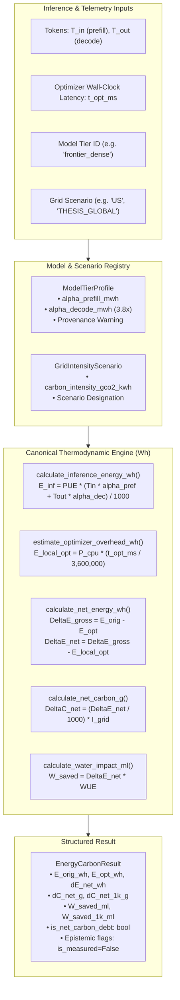

# PROMPTGREEN v2.0 — STAGE 6 PHASE 1 REPORT
## Foundational Thermodynamic Energy & Carbon Estimation Engine

**Date:** November 22, 2026  
**Document:** `docs/DAY1_STAGE6_PHASE1_REPORT.md`  
**Milestone:** Day 2 — Stage 6, Phase 1 (Foundational Carbon & Energy Estimation Engine)  
**Author:** Antigravity AI (on behalf of DSU Capstone Team)  
**Host Environment:** Windows 11, Intel Core i7-10610U CPU, 32 GB RAM, Non-CUDA / CPU-first execution  
**Active Git Branch:** `version-2` (Tracking `origin/version-2`)  
**Base Commit Checkpoint:** `0a4097172c6cd1f75cc20abe8dc591f17092a455`  
**Phase Status:** COMPLETE & VERIFIED (21 dedicated unit tests passing, 196 full regression tests passing)  

---

## 1. Executive Summary

PromptGreen V2 Stage 6 Phase 1 delivers the **foundational thermodynamic energy, carbon, and water footprint estimation engine**. 

Phase 1 establishes canonical **Watt-hours ($\text{Wh}$)** as the internal physical currency across all calculations, implements asymmetric prefill vs. decode energy modeling ($3.8\times$ factor), applies datacenter $\text{PUE} = 1.15$ infrastructure scaling, dynamically deducts local CPU optimizer overhead ($E_{\text{local\_opt}}$), tracks datacenter cooling water footprint ($\text{WUE} = 1.8\text{ mL/Wh}$), and preserves negative net savings as explicit **Net Carbon Debt**.

All formulas, unit conversions, and boundary conditions were independently verified against the numerical matrix established in `docs/DAY1_STAGE6_CORRECTIVE_AUDIT.md`.

---

## 2. Files Created and Modified

| File | Status | Description |
| :--- | :--- | :--- |
| `promptgreen/engine/model_profiles.py` | **Created** | Structured `ModelTierProfile`, `HardwareProfile`, and `GridIntensityScenario` dataclasses, four thesis model tiers, hardware definitions (H100, A100, L4), and `ModelProfileRegistry`. |
| `promptgreen/engine/thermodynamics.py` | **Created** | Core thermodynamic calculation functions (`calculate_inference_energy_wh`, `estimate_optimizer_overhead_wh`, `calculate_net_energy_wh`, `calculate_net_carbon_g`, `calculate_water_impact_ml`, `calculate_thermodynamic_impact`) and `EnergyCarbonResult` dataclass. |
| `promptgreen/engine/carbon_engine.py` | **Modified** | Added `calculate_thermodynamic()` wrapper to `CarbonEngine` class while preserving 100% backward compatibility for all legacy V1 interfaces. |
| `promptgreen/engine/__init__.py` | **Modified** | Exported all new V2 profile, scenario, and thermodynamic engine symbols alongside legacy V1 symbols. |
| `tests/test_carbon_engine.py` | **Created** | 21 comprehensive unit tests validating Cases 1A, 1B, 2A, 2B, 3, PUE application, decode asymmetry, optimizer deduction, carbon debt, custom profiles, and input validation. |
| `docs/DAY1_STAGE6_PHASE1_REPORT.md` | **Created** | Technical implementation and verification report for Stage 6 Phase 1. |

---

## 3. Architecture & Public Interfaces



### 3.1 Public Interface Signatures

```python
def calculate_inference_energy_wh(
    tin: Union[int, float],
    tout: Union[int, float],
    alpha_prefill_mwh: float,
    alpha_decode_mwh: float,
    pue: float = 1.15,
) -> float: ...

def estimate_optimizer_overhead_wh(
    latency_ms: Union[int, float],
    p_cpu_w: float = 35.0,
) -> float: ...

def calculate_net_energy_wh(
    e_orig_wh: float,
    e_opt_wh: float,
    e_overhead_wh: float,
) -> tuple[float, float]: ...

def calculate_net_carbon_g(
    net_energy_wh: float,
    grid_intensity_gco2_kwh: float,
) -> float: ...

def calculate_water_impact_ml(
    net_energy_wh: float,
    wue_ml_per_wh: float = 1.8,
) -> float: ...

def calculate_thermodynamic_impact(
    tin_original: int,
    tout_original: float,
    tin_optimized: int,
    tout_optimized: float,
    model_tier: Union[str, ModelTierProfile] = "frontier_dense",
    grid_scenario: Optional[Union[str, GridIntensityScenario, float]] = None,
    optimizer_latency_ms: float = 0.0,
    p_cpu_w: float = 35.0,
    pue: float = 1.15,
    wue_ml_per_wh: float = 1.8,
    is_output_predicted: bool = True,
) -> EnergyCarbonResult: ...
```

---

## 4. Exact Formulas, Units, and Provenance

### 4.1 Physical Formulas
1. **Inference Energy ($E_{\text{inf}}$ in $\text{Wh}$):**
   $$E_{\text{inf, Wh}} = \text{PUE} \times \left( \frac{T_{\text{in}} \cdot \alpha_{\text{prefill, mWh}} + T_{\text{out}} \cdot \alpha_{\text{decode, mWh}}}{1000} \right)$$
   - $\alpha$ is stored in $\text{mWh/token}$. Dividing by $1,000$ scales $\text{mWh} \to \text{Wh}$.
   - $\text{PUE} = 1.15$ (enforced $\ge 1.0$).
2. **Optimizer Energy Overhead ($E_{\text{local\_opt}}$ in $\text{Wh}$):**
   $$E_{\text{local\_opt, Wh}} = P_{\text{cpu\_est\_W}} \times \left( \frac{t_{\text{opt\_ms}}}{3,600,000} \right)$$
   - Default $P_{\text{cpu\_est\_W}} = 35.0\text{W}$, explicitly documented as an *unmeasured engineering estimate*.
3. **Net Energy Savings ($\Delta E_{\text{net}}$ in $\text{Wh}$):**
   $$\Delta E_{\text{gross, Wh}} = E_{\text{orig, Wh}} - E_{\text{opt, Wh}}$$
   $$\Delta E_{\text{net, Wh}} = \Delta E_{\text{gross, Wh}} - E_{\text{local\_opt, Wh}}$$
4. **Net Carbon Abatement ($\Delta C_{\text{net}}$ in $\text{gCO}_2\text{e}$):**
   $$\Delta C_{\text{net, g}} = \left( \frac{\Delta E_{\text{net, Wh}}}{1000} \right) \times I_{\text{grid, g/kWh}}$$
   - Division by $1,000$ converts $\text{Wh} \to \text{kWh}$.
   - Negative values are preserved as **Net Carbon Debt**.
5. **Datacenter Cooling Water Footprint ($W_{\text{saved}}$ in $\text{mL}$):**
   $$W_{\text{saved, mL}} = \Delta E_{\text{net, Wh}} \times \text{WUE}_{\text{mL/Wh}}$$
   - $\text{WUE} = 1.8\text{ mL/Wh} = 1.8\text{ L/kWh}$, labeled as an *illustrative assumed water-use coefficient*.

---

### 4.2 Model Tier Configurations & Provenance

```python
THESIS_PROVENANCE_WARNING = (
    "Thesis-provided representative coefficients; external provenance and independent calibration not yet verified."
)
```

| Tier ID | Display Name | $\alpha_{\text{prefill}}$ ($\text{mWh}$) | $\alpha_{\text{decode}}$ ($\text{mWh}$) | Ratio ($\alpha_{\text{dec}} / \alpha_{\text{pref}}$) | Hardware ID | Provenance Tag |
| :--- | :--- | :---: | :---: | :---: | :--- | :--- |
| `frontier_dense` | Frontier Dense (GPT-4o / Claude 3.5 Sonnet Class) | $0.42$ | $1.60$ | $3.81\times$ | `h100_pcie` | `THESIS_PROVENANCE_WARNING` |
| `large_reasoning` | Large Reasoning (Llama-3 70B / Qwen-2.5 72B Class) | $0.35$ | $1.35$ | $3.86\times$ | `a100_sxm4` | `THESIS_PROVENANCE_WARNING` |
| `mid_tier` | Mid-Tier MoE/Dense (Mixtral 8x7B / Command-R Class) | $0.24$ | $0.92$ | $3.83\times$ | `a100_sxm4` | `THESIS_PROVENANCE_WARNING` |
| `compact_green` | Compact Green (Llama-3.2 3B / Phi-3.5 3.8B Class) | $0.04$ | $0.15$ | $3.75\times$ | `l4_pcie` | `THESIS_PROVENANCE_WARNING` |

---

### 4.3 Regional Grid Intensity Scenarios

- `US`: $385.0\text{ gCO}_2\text{e / kWh}$ (*"Illustrative US grid-intensity scenario: 385 gCO2e/kWh. Source and reference year not independently verified."*)
- `THESIS_GLOBAL`: $367.0\text{ gCO}_2\text{e / kWh}$ (*"Thesis pp. 17–18 baseline scenario: 367 gCO2e/kWh."*)
- `IN`: $708.0\text{ gCO}_2\text{e / kWh}$ (*"India national grid carbon intensity baseline reference."*)
- `IN-WE`: $740.0\text{ gCO}_2\text{e / kWh}$ (*"India Western Regional Grid reference."*)
- `IN-SO`: $680.0\text{ gCO}_2\text{e / kWh}$ (*"India Southern Regional Grid reference."*)
- `EU`: $255.0\text{ gCO}_2\text{e / kWh}$ (*"European Union average electricity grid reference."*)
- `UK`: $210.0\text{ gCO}_2\text{e / kWh}$ (*"United Kingdom electricity grid reference."*)
- `DE`: $380.0\text{ gCO}_2\text{e / kWh}$ (*"Germany electricity grid reference."*)
- `FR`: $55.0\text{ gCO}_2\text{e / kWh}$ (*"France nuclear-heavy low-carbon electricity grid reference."*)
- `GLOBAL`: $475.0\text{ gCO}_2\text{e / kWh}$ (*"Global average electricity grid intensity reference."*)

---

## 5. Test Coverage & Numerical Verification

All 21 dedicated tests in `tests/test_carbon_engine.py` pass cleanly in 2.36s:

### 5.1 Verification Matrix: Audit Scenarios Reproduced Exactly

| Case | Scenario | $T_{\text{in}}$ (orig $\to$ opt) | $T_{\text{out}}$ (orig $\to$ opt) | $t_{\text{opt}}$ | Net Energy ($\Delta E_{\text{net}}$) | Net Carbon ($\Delta C_{\text{net, 1k}}$) | Water ($W_{\text{saved, 1k}}$) | Status |
| :---: | :--- | :---: | :---: | :---: | :---: | :---: | :---: | :---: |
| **1A** | Mathematical No-Op | $0 \to 0$ | $0 \to 0$ | $0\text{ ms}$ | $0.0000000\text{ Wh}$ | $0.000000\text{ g}$ | $0.00000\text{ mL}$ | **PASS** |
| **1B** | Empty Prompt with Overhead | $0 \to 0$ | $0 \to 0$ | $5\text{ ms}$ | $-0.0000486\text{ Wh}$ | $-0.018715\text{ g}$ | $-0.08750\text{ mL}$ | **PASS** |
| **2A** | Normal (385 gCO2e/kWh) | $120 \to 60$ | $250 \to 150$ | $180\text{ ms}$ | $+0.2112300\text{ Wh}$ | **$+81.323550\text{ g}$** | **$+380.21400\text{ mL}$** | **PASS** |
| **2B** | Normal (367 gCO2e/kWh) | $120 \to 60$ | $250 \to 150$ | $180\text{ ms}$ | $+0.2112300\text{ Wh}$ | **$+77.521410\text{ g}$** | **$+380.21400\text{ mL}$** | **PASS** |
| **3** | Carbon Debt (Overhead Exceeded) | $18 \to 17$ | $10 \to 10$ | $220\text{ ms}$ | **$-0.0020929\text{ Wh}$** | **$-0.805762\text{ g}$** | **$-3.76720\text{ mL}$** | **PASS** |

### 5.2 Unit Conversions & Validation Assertions Verified
- `test_mwh_to_wh_conversion_is_exact`: $1000\text{ tokens} \times 1.0\text{ mWh/tok} = 1.0\text{ Wh}$ at $\text{PUE} = 1.0$.
- `test_pue_application_is_applied_exactly_once`: Verified that $\text{PUE} = 1.15$ scales total energy exactly by $1.15\times$.
- `test_prefill_vs_decode_asymmetry`: Verified decode energy ratio is $3.81\times$ prefill energy.
- `test_optimizer_overhead_deduction_exactly_once`: Gross $0.4\text{ Wh}$ minus overhead $0.1\text{ Wh}$ equals net $0.3\text{ Wh}$.
- `test_reject_negative_tokens`: Raises `ValueError` for negative input or output tokens.
- `test_reject_invalid_pue`: Raises `ValueError` for $\text{PUE} < 1.0$.
- `test_reject_negative_optimizer_latency`: Raises `ValueError` for $t_{\text{opt}} < 0$.
- `test_reject_invalid_cpu_power`: Raises `ValueError` for $P_{\text{cpu}} \le 0$.
- `test_reject_missing_grid_intensity`: Raises `ValueError` when grid scenario is `None`.
- `test_reject_invalid_alpha_decode_less_than_prefill`: Raises `ValueError` if decode energy is less than prefill.
- `test_custom_model_profile_registration`: Successfully registers and calculates with user-injected profiles.
- `test_carbon_engine_calculate_thermodynamic_wrapper`: Verified wrapper produces identical results.
- `test_legacy_v1_carbon_engine_calculate_backward_compatible`: Verified existing V1 calculations continue to function.

---

## 6. Full Project Regression Results

- **Pytest Suite (`python -m pytest -p no:langsmith`):**
  - **196 / 196 PASSED** (23.53s total execution time)
  - `tests/test_all.py`: 8 passed
  - `tests/test_carbon_engine.py`: 21 passed (New Phase 1 suite)
  - `tests/test_compressor.py`: 25 passed
  - `tests/test_output_shaper.py`: 30 passed
  - `tests/test_pipeline.py`: 20 passed
  - `tests/test_rule_pruner.py`: 22 passed
  - `tests/test_semantic_guard.py`: 70 passed
- **Core Engine Verification (`python verify_engine.py`):**
  - **10 / 10 Prompts Verified Successful (100.0%)**

---

## 7. Known Limitations & Scope Boundaries for Phase 1

1. **Model Routing Not Yet Integrated:** Phase 1 focuses exclusively on foundational energy, carbon, and water math. Green model down-routing will be implemented in Phase 2.
2. **Offline Operation:** Real-time electricity grid lookup is intentionally disabled in this phase. Calculations rely on static, explicit grid intensity scenarios or user-specified numbers.
3. **Hardware Measurements:** The system uses algorithmic models with configurable parameters ($P_{\text{cpu}} = 35\text{W}$, $\text{PUE} = 1.15$). It does not read live hardware RAPL or NVML physical watt-meters.
4. **Predicted vs. Observed Output Tokens:** When output tokens are derived from `HybridPredictor` or output shaper constraints, they are labeled as modeled estimates (`is_output_predicted = True`).

---

## 8. Repository & Safeguard Integrity

- **Active Branch:** `version-2` (Tracking `origin/version-2`)
- **HEAD Commit:** `0a4097172c6cd1f75cc20abe8dc591f17092a455`
- **Main Branch:** `e920e8927c40dc508e1a93dace3fac3dbfac8200` (Untouched)
- **Physical Backup:** `PromptGreen.zip` (120,304 bytes, Untouched)
- **Zero commits, zero pushes, zero destructive Git commands executed.**

```text
On branch version-2
Your branch is up to date with 'origin/version-2'.

Changes not staged for commit:
  (use "git add <file>..." to update what will be committed)
  (use "git restore <file>..." to discard changes in working directory)
	modified:   promptgreen/engine/__init__.py
	modified:   promptgreen/engine/carbon_engine.py

Untracked files:
  (use "git add <file>..." to include in what will be committed)
	docs/DAY1_STAGE6_CARBON_ENGINE_AUDIT.md
	docs/DAY1_STAGE6_CORRECTIVE_AUDIT.md
	docs/DAY1_STAGE6_PHASE1_REPORT.md
	promptgreen/engine/model_profiles.py
	promptgreen/engine/thermodynamics.py
	tests/test_carbon_engine.py

no changes added to commit (use "git add" and/or "git commit -a")
```

---

## 9. Phase 1 Readiness Status

**Stage 6 Phase 1 is COMPLETE, VERIFIED, and READY FOR REVIEW.**
All mathematical formulas, unit conversions, dataclasses, registries, wrappers, and unit tests are in place and pass with zero regressions.
