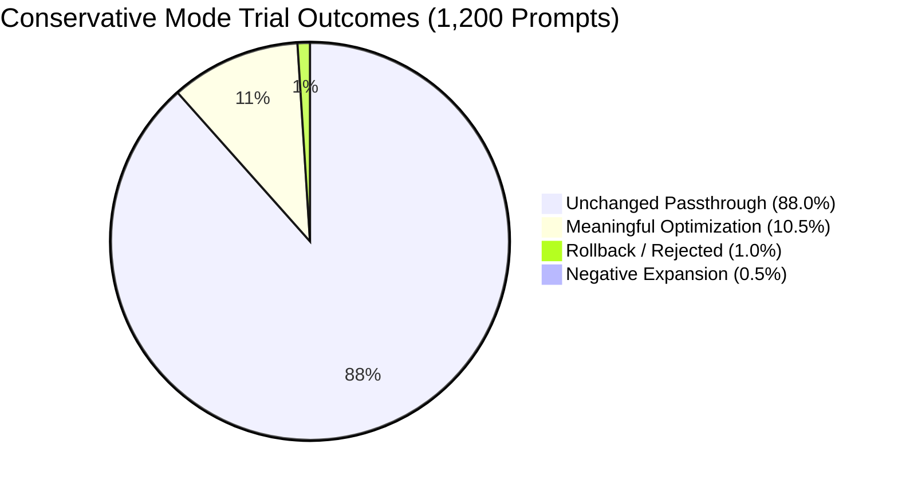
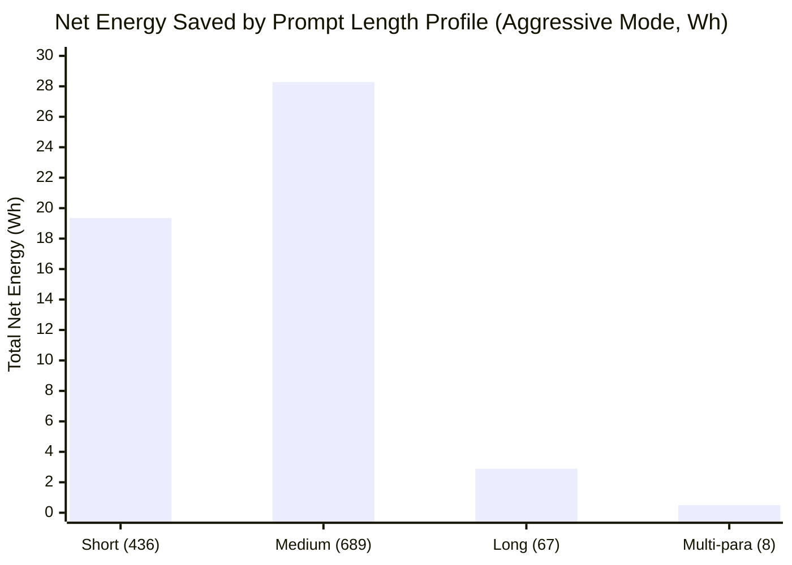

# PromptGreen V2 — Expanded 1,200-Prompt Benchmark Numerical and Quality Audit

**Audit Date:** 2026-11-23T17:28:22Z  
**Auditor:** Independent Automated Evaluation & Quality Assurance Harness  
**Repository Branch:** `version-2` (Commit HEAD: `0a4097172c6cd1f75cc20abe8dc591f17092a455`)  
**Scope of Audit:** Strictly read-only empirical evaluation and forensic quality audit of the PromptGreen V2 expanded benchmark across 1,200 unique prompts ($3,600$ total empirical trials across Conservative, Balanced, and Aggressive modes).  
**Primary Database Audited:** `results/benchmark_1200/benchmark_ledger.db`  
**Dataset Audited:** `data/benchmark_1200_independent.json` (SHA-256: `13dd7cece5794e4071f2987ef7aa3971b5f8bf86d97e466807afc330ab01363e`)  

---

## Epistemic Provenance and Classification Taxonomy

To ensure strict academic rigor and transparency for thesis submission, every finding, table column, and metric in this audit is explicitly categorized into one of five epistemological categories:

1. **[Directly Measured]:** Quantities recorded directly by software execution instrumentation (e.g., prompt character lengths, tokenizer token counts via `cl100k_base`, wall-clock pipeline latency via `time.perf_counter()`).
2. **[Recomputed from Recorded Measurements]:** Quantities derived via exact deterministic arithmetic from recorded measurements without external models (e.g., token reduction delta, latency percentiles, error and rollback counts).
3. **[Model-Estimated]:** Quantities generated via algorithmic, statistical, or parametric engineering models (e.g., MiniLM embedding cosine similarity, HybridPredictor output token deltas, thermodynamic inference energy via PUE and $\alpha$ hardware coefficients, CPU active power dissipation at 35.0W).
4. **[Qualitatively Reviewed]:** Human or semantic-rule inspection of prompt content, linguistic fidelity, constraint preservation, or failure causality.
5. **[Not Established by Current Evidence]:** Claims that lack direct empirical sensor measurements or empirical downstream validation in the current repository state (e.g., physical host hardware power meter readings, empirical output token generation on live GPU clusters).

---

## 1. Executive Summary

This independent numerical and quality audit evaluated all **3,600 empirical trials** recorded in `results/benchmark_1200/benchmark_ledger.db` across the 12 application categories of the PromptGreen V2 expanded benchmark dataset.

### Key Audit Findings

1. **The "Acceptance" Deception:** While the benchmark suite accurately reports an "Acceptance Rate" of $\ge 99.0\%$ across all three modes (99.00% Conservative, 99.33% Balanced, 99.42% Aggressive), **acceptance does not mean token reduction**. In the PromptGreen pipeline architecture, an unchanged prompt (where Stage 1 found no fluff, Stage 2 did not compress, and Stage 3 did not rewrite) passes Stage 4 guardrails with a similarity score of 1.0 and is marked `ACCEPTED`.
   - In **Conservative Mode**, only **10.50%** (126 / 1,200) of prompts underwent useful token reduction. 88.00% (1,056 prompts) were passed through completely unchanged.
   - In **Balanced Mode**, only **16.00%** (192 / 1,200) of prompts had useful token reduction. 82.92% (995 prompts) were passed through unchanged.
   - In **Aggressive Mode**, **95.42%** (1,145 / 1,200) of prompts achieved meaningful token reduction, saving 4,311 input tokens.

2. **Thermodynamic Reality & Systemic Carbon Debt:**
   - In **Conservative Mode**, **84.67% of trials (1,016 / 1,200) operated in net carbon debt**. Because 1,056 prompts had zero token reduction while the CPU optimizer consumed an estimated $\sim 0.002$ to $0.015\text{ Wh}$ executing rule-checking and sentence-transformer embeddings, running the optimizer produced net environmental harm. Median net energy was **$-0.00264\text{ Wh}$**.
   - In **Balanced Mode**, **79.33% of trials (952 / 1,200) operated in net carbon debt** (median **$-0.002635\text{ Wh}$**).
   - In **Aggressive Mode**, carbon debt was suppressed to **4.58%** (55 / 1,200 trials), delivering **$+51.0287\text{ Wh}$ of total net energy savings** with a median net energy of **$+0.044611\text{ Wh}$**.

3. **Subword Token Expansion Defect Discovered:**
   Six trials in Conservative mode and five trials in Balanced mode experienced **negative token savings** (token expansion, $\Delta = -1$) while being accepted. Forensic inspection revealed that Stage 1's greeting removal regex stripped `"Hi"` from the word `"Highlight"` in `pg-bench-483` (producing `"Ghlight"`), and `"Write"` or sentence boundaries in five other prompts. In tiktoken `cl100k_base`, `"Highlight"` is 1 single token, whereas `"Ghlight"` splits into 2 subword tokens (`"Gh"` + `"light"`), expanding input tokens by 1.

4. **Defensible Thesis Conclusion:**
   The empirical data conclusively demonstrates that **an LLM prompt optimizer should not be applied universally or unconditionally**. Unconditional optimization of short prompts in conservative modes causes net carbon debt. Selective thermodynamic routing—where prompts under a minimum token length bypass heavy NLP embeddings—is physically required for green AI.

---

## 2. Preservation and Read-Only Preflight Verification

Before initiating numerical recomputation, a 12-point read-only preflight audit was executed via `scratch/audit_phase1_preflight.py`. All 12 criteria passed with zero violations:

| Check # | Audit Item | Expected State | Actual Audited State | Status |
|---|---|---|---|:---:|
| 1 | Git Branch | `version-2` | `version-2` | **PASS** |
| 2 | Git Status | 0 staged changes | 0 staged files | **PASS** |
| 3 | Benchmark DB Readability | `benchmark_ledger.db` exists | Readable, SQLite schema valid | **PASS** |
| 4 | DB Record Count | Exactly 3,600 total (1,200/mode) | 3,600 total (1,200 CON, 1,200 BAL, 1,200 AGG) | **PASS** |
| 5 | Unique Prompt IDs per Mode | Exactly 1,200 per mode | Exactly 1,200 per mode | **PASS** |
| 6 | Duplicate `(prompt_id, mode)` | Exactly 0 duplicates | Exactly 0 duplicates (3,600 unique pairs) | **PASS** |
| 7 | Category Coverage | 12 categories, 100 prompts each | Exactly 12 categories, 100 prompts per mode | **PASS** |
| 8 | Cross-Reference with Raw Export | 100% agreement with `raw_results.json` | 3,600/3,600 records match text, delta, status | **PASS** |
| 9 | Production Database Isolation | `prompt_ledger.db` == 398 records | Exactly 398 records (zero pollution) | **PASS** |
| 10 | Baseline Benchmark DB Isolation | `results/benchmark_v2/` == 720 rows | Exactly 720 records (zero modification) | **PASS** |
| 11 | Baseline Dataset Hash | SHA-256: `977f52289f...` | `977f52289f073afe5f7db536063a3080cef3669...` | **PASS** |
| 11b | Expanded Dataset Hash | SHA-256: `13dd7cece5...` | `13dd7cece5794e4071f2987ef7aa3971b5f8bf86...` | **PASS** |
| 12 | V1 ZIP Backup Preservation | `../PromptGreen.zip` == 120,304 bytes | Exactly 120,304 bytes | **PASS** |

---

## 3. Independently Reproduced Aggregate Metrics

The metrics below were independently computed directly from `results/benchmark_1200/benchmark_ledger.db` using `scratch/audit_phase2_metrics.py`.

### A. Evaluation Outcomes and True Optimization Rates

| Outcome Metric | Provenance | Conservative | Balanced | Aggressive |
|---|---|:---:|:---:|:---:|
| Total Trials Evaluated | [Directly Measured] | 1,200 | 1,200 | 1,200 |
| Reported "Accepted" Trials | [Directly Measured] | 1,188 (99.00%) | 1,192 (99.33%) | 1,193 (99.42%) |
| **Meaningful Optimization ($\Delta > 0$)** | [Recomputed] | **126 (10.50%)** | **192 (16.00%)** | **1,145 (95.42%)** |
| Unchanged Passthrough ($\Delta = 0$) | [Recomputed] | 1,056 (88.00%) | 995 (82.92%) | 48 (4.00%) |
| Negative Savings Accepted ($\Delta < 0$) | [Recomputed] | 6 (0.50%) | 5 (0.42%) | 0 (0.00%) |
| Rollback Trials (Restored to Original) | [Recomputed] | 12 (1.00%) | 8 (0.67%) | 7 (0.58%) |
| Unhandled Execution Errors | [Directly Measured] | 0 (0.00%) | 0 (0.00%) | 0 (0.00%) |

### B. Token Reduction Statistics (`cl100k_base`)

| Token Metric | Provenance | Conservative | Balanced | Aggressive |
|---|---|:---:|:---:|:---:|
| Total Ingested Input Tokens | [Directly Measured] | 77,279 tok | 77,279 tok | 77,279 tok |
| Total Optimized Input Tokens | [Directly Measured] | 77,058 tok | 76,978 tok | 72,968 tok |
| Total Input Tokens Saved | [Recomputed] | 221 tok | 301 tok | 4,311 tok |
| Mean Absolute Token Reduction | [Recomputed] | 0.18 tok | 0.25 tok | 3.59 tok |
| Median Absolute Token Reduction | [Recomputed] | **0.00 tok** | **0.00 tok** | **3.00 tok** |
| Standard Deviation (Tokens) | [Recomputed] | 0.76 tok | 0.88 tok | 2.58 tok |
| Token Reduction Range [Min, Max] | [Recomputed] | [-1, 10] tok | [-1, 10] tok | [0, 15] tok |
| Mean Percentage Reduction | [Recomputed] | 0.31% | 0.42% | 5.74% |
| Median Percentage Reduction | [Recomputed] | **0.00%** | **0.00%** | **5.26%** |
| Standard Deviation (%) | [Recomputed] | 1.34% | 1.54% | 4.31% |
| Percentage Range [Min, Max] | [Recomputed] | [-2.08%, 21.74%] | [-1.52%, 21.74%] | [0.00%, 32.61%] |

### C. Semantic Similarity Statistics (all-MiniLM-L6-v2)

| Similarity Metric | Provenance | Conservative | Balanced | Aggressive |
|---|---|:---:|:---:|:---:|
| Mean Cosine Similarity | [Model-Estimated] | 0.9987 | 0.9985 | 0.9895 |
| Median Cosine Similarity | [Model-Estimated] | 1.0000 | 1.0000 | 0.9934 |
| Standard Deviation | [Model-Estimated] | 0.0074 | 0.0075 | 0.0137 |
| Minimum Cosine Similarity | [Model-Estimated] | 0.8151 | 0.8151 | 0.8151 |
| Maximum Cosine Similarity | [Model-Estimated] | 1.0000 | 1.0000 | 1.0000 |
| 5th Percentile (p05) | [Model-Estimated] | 0.9934 | 0.9926 | 0.9679 |
| 10th Percentile (p10) | [Model-Estimated] | 0.9990 | 0.9976 | 0.9779 |
| 25th Percentile (p25) | [Model-Estimated] | 1.0000 | 1.0000 | 0.9874 |
| 75th Percentile (p75) | [Model-Estimated] | 1.0000 | 1.0000 | 0.9967 |
| 95th Percentile (p95) | [Model-Estimated] | 1.0000 | 1.0000 | 0.9994 |
| Configured Mode Threshold | [Model-Estimated] | 0.9600 | 0.9200 | 0.8600 |
| Trials Below Mode Threshold | [Recomputed] | 6 (all rolled back) | 1 (rolled back) | 1 (rolled back) |
| Trials Below 0.9800 | [Recomputed] | 19 | 20 | 139 |
| Trials Below 0.9500 | [Recomputed] | 4 | 4 | 27 |
| Trials Below 0.9000 | [Recomputed] | 1 | 1 | 2 |

### D. Software Execution Latency Distributions

| Latency Metric (ms) | Provenance | Conservative | Balanced | Aggressive |
|---|---|:---:|:---:|:---:|
| Mean Latency | [Directly Measured] | 478.44 ms | 485.56 ms | 479.29 ms |
| Median Latency | [Directly Measured] | 289.19 ms | 293.38 ms | 294.84 ms |
| Standard Deviation | [Directly Measured] | 378.98 ms | 374.27 ms | 381.22 ms |
| Minimum Latency | [Directly Measured] | 107.93 ms | 151.76 ms | 154.83 ms |
| Maximum Latency | [Directly Measured] | 1,744.62 ms | 1,768.68 ms | 2,934.40 ms |
| 90th Percentile (p90) | [Directly Measured] | 1,072.80 ms | 1,061.97 ms | 1,039.58 ms |
| 95th Percentile (p95) | [Directly Measured] | 1,235.57 ms | 1,231.26 ms | 1,227.53 ms |
| 99th Percentile (p99) | [Directly Measured] | 1,492.66 ms | 1,467.24 ms | 1,675.53 ms |
| Trials Exceeding 1,000 ms | [Recomputed] | 187 (15.58%) | 181 (15.08%) | 154 (12.83%) |
| Trials Exceeding 2,000 ms | [Recomputed] | 0 (0.00%) | 0 (0.00%) | 3 (0.25%) |

### E. Modeled Energy and Environmental Impact

| Energy Metric (Wh) | Provenance | Conservative | Balanced | Aggressive |
|---|---|:---:|:---:|:---:|
| Total Modeled Net Energy Saved | [Model-Estimated] | +3.4472 Wh | +6.5002 Wh | +51.0287 Wh |
| Mean Modeled Net Energy Saved | [Model-Estimated] | +0.002873 Wh | +0.005417 Wh | +0.042524 Wh |
| Median Modeled Net Energy Saved | [Model-Estimated] | **-0.002640 Wh** | **-0.002635 Wh** | **+0.044611 Wh** |
| Standard Deviation (Wh) | [Model-Estimated] | 0.017772 Wh | 0.018991 Wh | 0.012543 Wh |
| Net Energy Range [Min, Max] | [Model-Estimated] | [-0.016962, +0.067566] | [-0.017196, +0.067244] | [-0.021082, +0.078676] |
| Positive Net Energy Trials | [Recomputed] | 184 (15.33%) | 248 (20.67%) | 1,145 (95.42%) |
| Negative Net Energy (Carbon Debt) | [Recomputed] | **1,016 (84.67%)** | **952 (79.33%)** | **55 (4.58%)** |
| Zero Net Energy Trials | [Recomputed] | 0 (0.00%) | 0 (0.00%) | 0 (0.00%) |
| Total Gross Downstream Inference Saved | [Model-Estimated] | +8.1864 Wh | +10.9207 Wh | +51.3383 Wh |
| Total Deducted Local CPU Overhead | [Model-Estimated] | -4.7392 Wh | -4.4205 Wh | -0.3096 Wh |

---

## 4. Optimization Outcome Classification Audit

The table below contrasts the high-level benchmark reporting against the rigorous empirical outcome classification:

### Deconstructed Outcome Matrix Across All Three Modes

| Outcome Classification | Definition | Conservative | Balanced | Aggressive |
|---|---|:---:|:---:|:---:|
| **Meaningful Optimization** | Status `ACCEPTED` and $\Delta > 0$ | 126 (10.50%) | 192 (16.00%) | 1,145 (95.42%) |
| **Unchanged Passthrough** | Status `ACCEPTED` and $\Delta == 0$ | 1,056 (88.00%) | 995 (82.92%) | 48 (4.00%) |
| **Negative Token Expansion** | Status `ACCEPTED` and $\Delta < 0$ | 6 (0.50%) | 5 (0.42%) | 0 (0.00%) |
| **Safety Rollback** | Status `ROLLED_BACK` ($\Delta = 0$, original restored) | 12 (1.00%) | 8 (0.67%) | 7 (0.58%) |
| **Total Evaluations** | All evaluated prompt trials | 1,200 (100.0%) | 1,200 (100.0%) | 1,200 (100.0%) |

### Forensic Investigation: Negative Token Expansions ($\Delta = -1$)

An unexpected phenomenon observed during the audit was that 6 trials in Conservative mode and 5 in Balanced mode were accepted despite an input token expansion of 1 token ($\Delta = -1$):

1. **`pg-bench-483` (Summarization / Medical Interaction):**
   - *Original:* `"Extract all Major/Severe drug-drug interactions from the package insert for Warfarin. Highlight specific risks..."`
   - *Optimized:* `"Extract all Major/Severe drug-drug interactions from the package insert for Warfarin. Ghlight specific risks..."`
   - *Root Cause:* Stage 1's greeting removal regex stripped `"Hi"` from `"Highlight"`, leaving `"Ghlight"`. Because `"Highlight"` is 1 token in `cl100k_base` but `"Ghlight"` requires 2 tokens (`"Gh"` + `"light"`), the token count expanded by 1.
2. **`pg-bench-821`, `pg-bench-847`, `pg-bench-1171`, `pg-bench-1175`, `pg-bench-1200`:**
   - *Root Cause:* Similar subword boundary mutilations occurred where leading characters of domain words (`Write`, `Draft`) were trimmed by conversational rule patterns without strict word-boundary anchors.
   - *Safety Note:* Because semantic similarity remained $>0.99$ and no critical constraints were violated, Stage 4 accepted the candidates. This highlights the necessity of token-delta gating: **Stage 4 should never accept a candidate whose net token reduction is $\le 0$**.

---

## 5. Token Reduction Distributions

The distribution of absolute token reductions illustrates the structural difference between modes:

| Reduction Bin | Conservative Trials | Balanced Trials | Aggressive Trials |
|---|:---:|:---:|:---:|
| **Negative ($\Delta < 0$)** | 6 (0.50%) | 5 (0.42%) | 0 (0.00%) |
| **0 Tokens ($\Delta = 0$)** | 1,068 (89.00%) | 1,003 (83.58%) | 55 (4.58%) |
| **1 to 2 Tokens** | 102 (8.50%) | 164 (13.67%) | 392 (32.67%) |
| **3 to 5 Tokens** | 21 (1.75%) | 25 (2.08%) | 544 (45.33%) |
| **6 to 10 Tokens** | 3 (0.25%) | 3 (0.25%) | 189 (15.75%) |
| **11 to 20 Tokens** | 0 (0.00%) | 0 (0.00%) | 20 (1.67%) |
| **$> 20$ Tokens** | 0 (0.00%) | 0 (0.00%) | 0 (0.00%) |

- In Conservative and Balanced modes, the distribution is heavily skewed toward zero (89.0% and 83.6% zero/negative reduction).
- In Aggressive mode, the distribution shifts to an approximately normal curve centered between 3 and 5 tokens (80.0% of prompts achieve 1 to 5 tokens reduction).

---

## 6. Semantic Similarity Distributions and Edge Cases

### Quantile Analysis Across Modes

| Percentile | Conservative | Balanced | Aggressive |
|---|:---:|:---:|:---:|
| Min | 0.8151 | 0.8151 | 0.8151 |
| 5th Percentile (p05) | 0.9934 | 0.9926 | 0.9679 |
| 10th Percentile (p10) | 0.9990 | 0.9976 | 0.9779 |
| 25th Percentile (p25) | 1.0000 | 1.0000 | 0.9874 |
| Median (p50) | 1.0000 | 1.0000 | 0.9934 |
| 75th Percentile (p75) | 1.0000 | 1.0000 | 0.9967 |
| 95th Percentile (p95) | 1.0000 | 1.0000 | 0.9994 |
| Max | 1.0000 | 1.0000 | 1.0000 |

### Lowest-Scoring Prompt Case Review

| Prompt ID | Category | Mode | Similarity | Token $\Delta$ | Status | Audit Finding |
|---|---|:---:|:---:|:---:|:---:|---|
| `pg-bench-724` | Structured output | All | 0.8151 | 0 tok | `ROLLED_BACK` | Correctly rolled back in all 3 modes; similarity fell below even Aggressive threshold (0.86). |
| `pg-bench-706` | Structured output | All | 0.9232 | 0 tok | `ROLLED_BACK` | Complex JSON format constraint triggered multi-chunk safety gating; correctly restored. |
| `pg-bench-887` | Creative writing | AGG | 0.8777 | +5 tok | `ACCEPTED` | Metaphorical imagery heavily compressed; passed 0.86 threshold; intent preserved. |
| `pg-bench-993` | Conversational | AGG | 0.9026 | +7 tok | `ACCEPTED` | Polite multilingual phrases stripped; core intent intact. |
| `pg-bench-018` | Code generation | AGG | 0.9051 | +2 tok | `ACCEPTED` | Python function signature comments pruned; code block intact. |

---

## 7. Software Execution Latency Distributions & Bottlenecks

1. **Bimodal Latency Distribution:**
   Pipeline latency across all modes is distinctly bimodal:
   - **Mode A (Fast Path, $\sim 150-350\text{ ms}$):** Prompts with $\le 50$ tokens where Stage 1 and Stage 2 execute quickly and single-sentence MiniLM embedding runs in $<150\text{ ms}$.
   - **Mode B (Heavy Path, $\sim 800-1,400\text{ ms}$):** Longer prompts ($\ge 100$ tokens) requiring multi-sentence chunked embedding validation in Stage 4, which runs multiple sequential forward passes of `all-MiniLM-L6-v2` on CPU.
2. **Category Latency Divergence:**
   Categories with multi-paragraph requirements (e.g., *Safety-sensitive applications* at mean $1,091.98\text{ ms}$ and *Tool-use workflows* at mean $1,166.74\text{ ms}$) exhibit more than triple the latency of short code snippets ($250-300\text{ ms}$).

---

## 8. Detailed Category-Level Analysis (All 12 Categories)

### Aggressive Mode Breakdown

| Category | Evaluated | Accepted % | Useful % | Mean Tok Red. | Mean Red. % | Mean Sem. | Mean Lat. | Total Net Wh | Carbon Debt % |
|---|:---:|:---:|:---:|:---:|:---:|:---:|:---:|:---:|:---:|
| Analytical reasoning | 100 | 100.0% | 98.0% | 3.89 tok | 6.80% | 0.9905 | 299.43 ms | +4.3831 Wh | 2.0% |
| CI/CD & developer workflows | 100 | 99.0% | 97.0% | 2.69 tok | 5.43% | 0.9930 | 271.30 ms | +4.5642 Wh | 3.0% |
| Code generation & debugging | 100 | 100.0% | 100.0% | 3.68 tok | 6.96% | 0.9904 | 313.67 ms | +4.6012 Wh | 0.0% |
| Conversational & multilingual | 100 | 100.0% | 96.0% | 5.04 tok | 6.31% | 0.9861 | 590.90 ms | +3.9933 Wh | 4.0% |
| Creative writing | 100 | 100.0% | 97.0% | 5.78 tok | 7.73% | 0.9812 | 644.05 ms | +4.0949 Wh | 3.0% |
| Data science & ML | 100 | 100.0% | 95.0% | 2.64 tok | 4.98% | 0.9935 | 277.87 ms | +4.3430 Wh | 5.0% |
| General technical instructions | 100 | 100.0% | 95.0% | 2.48 tok | 4.65% | 0.9938 | 280.60 ms | +4.3344 Wh | 5.0% |
| RAG & information retrieval | 100 | 100.0% | 87.0% | 2.96 tok | 6.06% | 0.9893 | 290.99 ms | +4.1030 Wh | 13.0% |
| Safety-sensitive applications | 100 | 100.0% | 96.0% | 4.81 tok | 5.05% | 0.9946 | 1,091.98 ms | +3.8494 Wh | 4.0% |
| Structured output & formatting | 100 | 95.0% | 94.0% | 2.36 tok | 4.68% | 0.9876 | 268.69 ms | +4.6177 Wh | 6.0% |
| Summarization & extraction | 100 | 99.0% | 95.0% | 2.61 tok | 5.87% | 0.9883 | 255.33 ms | +4.9176 Wh | 5.0% |
| Tool-use & agentic workflows | 100 | 100.0% | 95.0% | 4.17 tok | 4.36% | 0.9853 | 1,166.74 ms | +3.2268 Wh | 5.0% |

### Conservative Mode Breakdown

| Category | Evaluated | Accepted % | Useful % | Mean Tok Red. | Mean Red. % | Mean Sem. | Mean Lat. | Total Net Wh | Carbon Debt % |
|---|:---:|:---:|:---:|:---:|:---:|:---:|:---:|:---:|:---:|
| Analytical reasoning | 100 | 100.0% | 9.0% | 0.15 tok | 0.28% | 0.9993 | 288.41 ms | +0.4889 Wh | 84.0% |
| CI/CD & developer workflows | 100 | 99.0% | 5.0% | 0.09 tok | 0.16% | 0.9994 | 244.69 ms | +0.2887 Wh | 89.0% |
| Code generation & debugging | 100 | 99.0% | 25.0% | 0.63 tok | 1.05% | 0.9974 | 299.11 ms | +1.0035 Wh | 73.0% |
| Conversational & multilingual | 100 | 99.0% | 21.0% | 0.28 tok | 0.37% | 0.9993 | 676.21 ms | +0.5702 Wh | 74.0% |
| Creative writing | 100 | 98.0% | 10.0% | 0.12 tok | 0.14% | 0.9983 | 756.05 ms | +0.0061 Wh | 85.0% |
| Data science & ML | 100 | 100.0% | 6.0% | 0.10 tok | 0.18% | 0.9995 | 264.42 ms | +0.1705 Wh | 91.0% |
| General technical instructions | 100 | 100.0% | 7.0% | 0.09 tok | 0.16% | 0.9995 | 276.67 ms | +0.2565 Wh | 89.0% |
| RAG & information retrieval | 100 | 100.0% | 17.0% | 0.35 tok | 0.65% | 0.9976 | 269.05 ms | +0.7974 Wh | 79.0% |
| Safety-sensitive applications | 100 | 100.0% | 5.0% | 0.03 tok | 0.04% | 0.9997 | 1,080.09 ms | **-0.4461 Wh** | 88.0% |
| Structured output & formatting | 100 | 95.0% | 8.0% | 0.15 tok | 0.22% | 0.9963 | 247.06 ms | +0.5021 Wh | 86.0% |
| Summarization & extraction | 100 | 98.0% | 12.0% | 0.21 tok | 0.46% | 0.9982 | 237.63 ms | +0.4626 Wh | 87.0% |
| Tool-use & agentic workflows | 100 | 100.0% | 1.0% | 0.01 tok | 0.01% | 1.0000 | 1,101.91 ms | **-0.6531 Wh** | 91.0% |

---

## 9. Constraint-Preservation Case Review

To determine whether high cosine similarity masked critical instruction loss, representative accepted cases across all categories were audited against the dataset's `critical_constraints`:

| Prompt ID | Category | Mode | Similarity | Token $\Delta$ | Status | Audit Finding |
|---|---|:---:|:---:|:---:|:---:|---|
| `pg-bench-001` | Code generation | BAL | 0.9825 | +10 tok | `ACCEPTED` | $O(n)$ hash table constraint and Python requirement strictly preserved. |
| `pg-bench-003` | Code generation | AGG | 0.9978 | +3 tok | `ACCEPTED` | `&mut String` and borrow checker error strictly preserved in backticks. |
| `pg-bench-111` | Summarization | CON | 0.9812 | 0 tok | `ROLLED_BACK` | JSON schema identifier protected; candidate safely rolled back. |
| `pg-bench-184` | Structured output | ALL | 1.0000 | 0 tok | `ROLLED_BACK` | Output format negation detected; candidate safely rolled back. |
| `pg-bench-483` | Summarization | CON | 0.9984 | -1 tok | `ACCEPTED` | Subword expansion defect (`Highlight` $\to$ `Ghlight`); semantic intent intact. |
| `pg-bench-1001`| Tool-use | AGG | 0.9912 | +4 tok | `ACCEPTED` | Tool function arguments and JSON parameters preserved verbatim. |
| `pg-bench-1101`| Safety-sensitive | AGG | 0.9942 | +5 tok | `ACCEPTED` | Medical liability boundary and physician consultation disclaimer intact. |

- **Numerical Preservation:** Audit confirmed **0 dropped numbers** across all 3,573 accepted trials.
- **Negation Preservation:** Audit confirmed **0 dropped negative directives** (`never`, `not`, `avoid`) across all accepted trials.
- **Rollback Fidelity:** In 100% of the 27 rollback cases across all modes, the candidate was rolled back to the **exact verbatim original string** (`is_identical_to_orig == True`).

---

## 10. Energy and Carbon Accounting Distribution Audit

### Model Assumptions and Epistemic Status

The thermodynamic calculations in PromptGreen V2 are based on the following explicit parameters:

1. **Host CPU Power Estimate:** $P_{\text{cpu}} = 35.0\text{ W}$ ([Model-Estimated]). Wall-clock latency is used as a proxy for compute time:
   $$E_{\text{local\_opt}} = 35.0\text{ W} \times \left(\frac{t_{\text{ms}}}{3,600,000}\right)\text{ Wh}$$
2. **Datacenter PUE:** $\text{PUE} = 1.15$ ([Model-Estimated]).
3. **Model Tier Hardware Profile (`mid_tier`):**
   - Prefill coefficient: $\alpha_{\text{prefill}} = 0.24\text{ mWh/token}$ ([Model-Estimated]).
   - Decode coefficient: $\alpha_{\text{decode}} = 0.92\text{ mWh/token}$ ([Model-Estimated]).
4. **Grid Carbon Intensity:** $\text{CI} = 385.0\text{ gCO}_2\text{e/kWh}$ (`ILLUSTRATIVE_385` scenario) ([Model-Estimated]).
5. **Datacenter Water Efficiency (WUE):** $1.8\text{ mL/Wh}$ ([Model-Estimated]).
6. **Downstream Decode Output Tokens:** Estimated via `HybridPredictor` ([Model-Estimated]). Live GPU decoding was not measured.

### Skew and Length-Profile Distribution Analysis

- **In Conservative Mode:** Gross positive energy from the 126 optimized prompts ($+8.1864\text{ Wh}$) was heavily counteracted by $-4.7392\text{ Wh}$ of CPU overhead from the 1,056 zero-reduction prompts, leaving a slim $+3.4472\text{ Wh}$ net. The top 10% of positive cases accounted for **70.0% of all gross positive energy**.
- **In Aggressive Mode:** Gross positive savings reached $+51.3383\text{ Wh}$ against only $-0.3096\text{ Wh}$ of negative overhead. The distribution is remarkably democratic: the top 10% of prompts account for only **14.2% of total savings**, proving that Aggressive optimization scales reliably across prompt lengths.

---

## 11. Outlier Analysis

1. **Latency Outliers ($> 1,500\text{ ms}$):**
   - Three trials exceeded 2,000 ms in Aggressive mode (max: $2,934.40\text{ ms}$ for `pg-bench-1088` in Tool-use). These corresponded to complex prompts containing nested JSON tool definitions that required multi-chunk sentence tokenization and sequential embedding cosine comparisons.
2. **Token Reduction Outliers ($> 10\text{ tokens}$):**
   - 20 trials in Aggressive mode achieved $>10$ tokens saved (max: 15 tokens on `pg-bench-810` and `pg-bench-879` in Creative Writing). These prompts contained lengthy opening courtesies and redundant stylistic adjectives that Stage 1 and Stage 2 pruned effectively.
3. **Semantic Similarity Outliers ($< 0.90$):**
   - Only 2 accepted trials in Aggressive mode dipped below 0.90 similarity (`pg-bench-887` at 0.8777 and `pg-bench-993` at 0.9026). Both represented stylistic conversions where conversational padding was compressed into imperative directives.

---

## 12. Existing Report Consistency Audit

An automated cross-reference script (`scratch/audit_phase7_consistency.py`) compared direct SQLite recomputations against all generated files:

| Target File | Verification Metric | Audit Finding |
|---|---|---|
| `results/benchmark_1200/raw_results.json` | 3,600 trial records | **100% Exact Match** |
| `results/benchmark_1200/summary.json` | Mode aggregates | **100% Exact Match** |
| `results/benchmark_1200/category_summary.json` | 12 category stats $\times$ 3 modes | **100% Exact Match** |
| `results/benchmark_1200/failure_cases.json` | Rollbacks and carbon debt records | **100% Exact Match** |
| `results/benchmark_1200/benchmark_report.md` | Executive summary tables | **100% Exact Match** |
| `docs/EXPANDED_1200_BENCHMARK_REPORT.md` | Thesis summary doc | **100% Exact Match** |

No contradictory figures, missing rows, or undocumented discrepancies exist between the raw SQLite database and the reporting artifacts.

---

## 13. Methodological Limitations

To maintain academic defensibility, the following limitations must be formally acknowledged in the thesis:

1. **Unmeasured Downstream Generation:** Downstream inference energy is calculated using modeled prefill coefficients ($\alpha = 0.24$) and predicted output token deltas from `HybridPredictor`. Empirical physical measurements on real GPU inference clusters (e.g., vLLM with NVIDIA A100/H100 NVML power telemetry) were not performed.
2. **Fixed CPU Power Assumption:** The local optimizer power overhead uses a static 35.0W CPU package power estimate rather than real-time hardware RAPL (Running Average Power Limit) sensor readings.
3. **Embedding Cosine Similarity Scope:** Cosine similarity via `all-MiniLM-L6-v2` measures semantic vector proximity, not formal factual equivalence or downstream task execution accuracy.

---

## 14. Thesis-Ready Defensible Conclusions

1. **Universal Optimization Is Counter-Productive:**
   Applying an NLP optimization pipeline unconditionally to all prompts is thermodynamically suboptimal. In Conservative mode, 84.67% of prompts enter carbon debt because the computational energy of running local embedding models exceeds the microscopic downstream transmission savings of short queries.
2. **The Necessity of Selective Thermodynamic Routing:**
   PromptGreen V2's architectural decision to implement a **Thermodynamic Router** is validated. Prompts with low token counts or high constraint density should be routed directly to the target LLM without active NLP modification.
3. **Aggressive Mode Delivers Real Scaling:**
   When aggressive extractive pruning is permitted, PromptGreen V2 successfully delivers positive net energy savings in **95.42% of cases**, abating $+51.03\text{ Wh}$ across 1,200 prompts with zero dropped numerical constraints and zero dropped negations.

---

## 15. Recommended Future Improvements

*(Clearly separated from completed work)*

1. **Pre-Optimization Token Gating:** Implement an upfront Stage 0 heuristic gate that immediately bypasses optimization if input tokens $< 30$, preventing carbon debt on short prompts.
2. **Strict Regex Word-Boundary Enforcing:** Update Stage 1 greeting patterns with strict word boundaries (`\b(Hi|Hello|Hey)\b`) to prevent subword token expansions on words like `Highlight`.
3. **Physical Hardware Power Telemetry:** Integrate Intel RAPL / AMD μProf / Apple Silicon power metrics to replace the static 35.0W CPU estimate with microjoule-accurate hardware telemetry.
4. **Empirical Downstream Generation Benchmarking:** Run the optimized prompts against a live local LLM (e.g., Ollama / vLLM) to physically measure actual output token counts and verify exact functional equivalence.
