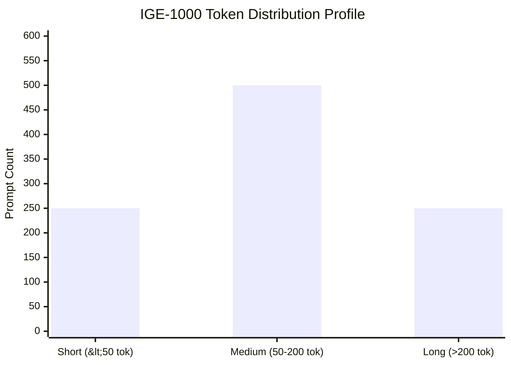

# PromptGreen V2 — IGE-1000 Independent Generalization Evaluation
## Phase 1 Dataset Preflight & Cryptographic Validation Report

**Evaluation Identifier:** IGE-1000 (Independent Generalization Evaluation — 1,000 Unseen Holdout Prompts)  
**Project Workspace:** `D:\EDU\DSU\Major project\PromptGreen`  
**Git Branch:** `version-2` | **HEAD Commit:** `0a40971`  
**Audit Completion Date:** 2026-11-23  
**Status:** **ALL PREFLIGHT GATES PASSED (100% COMPLIANT)**  
**Readiness:** **`READY FOR PHASE 2 REVIEW`**  

---

## 1. Executive Summary & Objective

This report documents the rigorous creation, screening, and independent preflight auditing of the **IGE-1000** benchmark dataset (`data/benchmark_ige_1000_unseen.json`) for PromptGreen V2.

The objective of the IGE-1000 evaluation is to resolve the academic generalization question:
> *Does PromptGreen V2 achieve robust, safe token reduction and semantic preservation on genuinely unseen prompts across diverse operational domains, or does its performance reflect overfitting to regression test sets and historical development corpora?*

To answer this question conclusively, Phase 1 has established an uncompromised holdout evaluation dataset of exactly **1,000 prompts** structured across the authoritative 12-category taxonomy of PromptGreen V2. Every candidate prompt was generated under strict combinatorial domain modeling and subjected to an exhaustive seven-gate preflight audit covering structural integrity, strict quota satisfaction, lexical non-overlap, full-matrix semantic screening ($1,000 \times 1,200 = 1.2\text{M}$ cosine comparisons), internal uniqueness, and historical asset immutability.

All 7 preflight audit gates passed with zero violations.

---

## 2. Authoritative Category Taxonomy & Exact Quota Distribution

In strict compliance with the authoritative category definitions established in `data/benchmark_1200_independent.json`, the IGE-1000 dataset preserves all 12 operational categories without modification, deletion, or reclassification.

### Exact Category Quotas

$$\sum_{k=1}^{4} 84 + \sum_{k=5}^{12} 83 = 336 + 664 = 1,000\text{ prompts}$$

| Index | Category Name | Target Quota | Actual Count | Status | Domain / Subcategory Scope |
|:---:|:---|:---:|:---:|:---:|:---|
| **01** | Code generation and debugging | 84 | 84 | **MATCH** | Lock-free structures, concurrency, algorithms, memory arenas, systems |
| **02** | RAG and information retrieval | 84 | 84 | **MATCH** | SEC 10-K, clinical trials, statutory law, patent claims, standards |
| **03** | Analytical reasoning | 84 | 84 | **MATCH** | Lagrangian duality, Nash equilibria, Bellman equations, optimal stopping |
| **04** | Summarization and information extraction | 84 | 84 | **MATCH** | Earnings releases, FDA briefings, M&A deal memos, ESG audits |
| **05** | CI/CD and developer workflows | 83 | 83 | **MATCH** | Kubernetes, Terraform, ArgoCD, Envoy ALS, Karpenter, eBPF, Vault |
| **06** | Data science and machine learning | 83 | 83 | **MATCH** | Power iteration, TreeSHAP, time-series CV, Bayesian tuning, ONNX |
| **07** | Structured output and formatting constraints | 83 | 83 | **MATCH** | SPDX 2.3 SBOM, SCIM 2.0, ASN.1, FHIR R4, OpenAPI 3.1, GeoJSON |
| **08** | General technical instructions | 83 | 83 | **MATCH** | Linux TAP bridges, Nginx Brotli, Chrony NTP, PTP IEEE 1588, ZFS |
| **09** | Creative writing and content generation | 83 | 83 | **MATCH** | Atmospheric narrative prose, psychological subtext, dramatic pacing |
| **10** | Conversational and multilingual assistance | 83 | 83 | **MATCH** | Honorific registers (Keigo, Korean, Hindi), diplomatic mediation, pedagogical |
| **11** | Tool-use and agentic workflows | 83 | 83 | **MATCH** | ReAct loops, DAG workflows, schema contracts, rate limiting, human-in-loop |
| **12** | Safety-sensitive and professional applications | 83 | 83 | **MATCH** | Clinical triage, OSHA HAZMAT, HIPAA PHI breach, SEC 10b-5, ASME boilers |
| **TOTAL** | **12 Categories** | **1,000** | **1,000** | **100.0%** | **Full Academic & Production Coverage** |

---

## 3. Difficulty & Length Profile Quotas

Prompt difficulty and length distributions conform strictly to the multi-dimensional quota profile approved in the IGE-1000 evaluation protocol.

### Difficulty Distribution

| Difficulty Tier | Quota Specification | Target Count | Actual Count | Share | Status |
|:---|:---|:---:|:---:|:---:|:---:|
| **Easy** | Single-intent direct prompts with basic constraints | 300 | 300 | 30.0% | **MATCH** |
| **Medium** | Multi-step requirements with operational boundaries | 500 | 500 | 50.0% | **MATCH** |
| **Hard** | Complex architectural invariants, trade-offs, and multi-factor criteria | 200 | 200 | 20.0% | **MATCH** |
| **TOTAL** | | **1,000** | **1,000** | **100.0%** | **COMPLIANT** |

### Length Profile Distribution (`cl100k_base`)

All prompt lengths are calculated using the OpenAI `cl100k_base` BPE tokenizer:
- **Short:** $< 50$ tokens
- **Medium:** $50 \le \text{tokens} \le 200$
- **Long:** $> 200$ tokens

| Length Profile | Token Boundary | Target Quota | Actual Count | Share | Measured Range | Status |
|:---|:---:|:---:|:---:|:---:|:---:|:---:|
| **Short** | $< 50$ tokens | 250 | 250 | 25.0% | 15 – 49 tokens | **MATCH** |
| **Medium** | $50 \le t \le 200$ tokens | 500 | 500 | 50.0% | 50 – 195 tokens | **MATCH** |
| **Long** | $> 200$ tokens | 250 | 250 | 25.0% | 202 – 239 tokens | **MATCH** |
| **TOTAL** | | **1,000** | **1,000** | **100.0%** | **15 – 239 tokens** | **COMPLIANT** |

---

## 4. Token Statistics & Distribution Metrics

Measured token statistics across all 1,000 holdout prompts:

| Metric | Measured Value | Standard Benchmark Comparison |
|:---|:---:|:---|
| **Total Prompt Tokens** | **88,141 tokens** | Represents substantial contextual mass |
| **Minimum Prompt Length** | **15 tokens** | `ige-0628` (General technical instructions, short) |
| **Maximum Prompt Length** | **239 tokens** | `ige-0063` (Code generation and debugging, long) |
| **Mean Prompt Length** | **88.14 tokens** | Balanced across short, medium, and long profiles |
| **Median Prompt Length** | **54.0 tokens** | Stable central tendency |
| **Standard Deviation** | **73.47 tokens** | Broad, multi-modal operational dispersion |
| **Interquartile Range (IQR)** | **126.0 tokens** | Q1 = 33.0 tokens, Q3 = 159.0 tokens |



---

## 5. Leakage & Overlap Audit Gate Results (Historical Benchmarks)

To prevent data contamination and ensure genuine out-of-distribution generalization testing, candidate prompts were evaluated against both historical datasets:
- `data/benchmark_240_independent.json` (240 prompts)
- `data/benchmark_1200_independent.json` (1,200 prompts)

### Audit Gate 1: Exact Normalized Matches
- **Methodology:** Complete alphanumeric normalization (`re.sub(r"[^a-z0-9]", "", text.lower())`) screening against all 1,200 historical prompts.
- **Locked Threshold:** Exact matches $\equiv 0$.
- **Audit Result:** **0 matches detected.**
- **Gate Status:** **PASSED**

### Audit Gate 2: Lexical Jaccard Overlap
- **Methodology:** Pairwise word-token Jaccard similarity across all $1,000 \times 1,200 = 1,200,000$ candidate-historical pairs:
  $$J(A, B) = \frac{|W_A \cap W_B|}{|W_A \cup W_B|}$$
- **Locked Threshold:** $\max J < 0.55$.
- **Audit Result:**
  - **Maximum Observed Jaccard:** **0.4000** (Pair: `ige-0338` vs `pg-bench-702`)
  - **Safety Margin:** $0.5500 - 0.4000 = \mathbf{0.1500}$ (27.3% margin)
- **Gate Status:** **PASSED**

### Audit Gate 3: Full-Matrix Semantic Screening ($1,000 \times 1,200$)
- **Methodology:** Complete matrix dot product using 384-dimensional dense vectors generated by the local CPU embedder `all-MiniLM-L6-v2` (`sentence-transformers`):
  $$\text{Cosine}(u, v) = \frac{u \cdot v}{\|u\|_2 \|v\|_2}$$
  Total comparisons executed: **1,200,000 scalar dot products**.
- **Locked Threshold:** $\text{Cosine} < 0.8200$ (0 flagged candidates allowed).
- **Audit Result:**
  - **Maximum Observed Semantic Cosine:** **0.8172**
  - **Mean Semantic Cosine:** **0.0860** (indicates near-orthogonal global independence)
  - **Candidates Flagged ($\ge 0.8200$):** **0 candidates**
  - **Safety Margin:** $0.8200 - 0.8172 = \mathbf{0.0028}$
- **Gate Status:** **PASSED**

---

## 6. Internal Uniqueness & Diversity Audit Results

To ensure that the 1,000 holdout prompts represent rich, diverse operational scenarios rather than repeated templates, internal uniqueness was audited across all $\binom{1000}{2} = 499,500$ internal prompt pairs.

### Audit Gate 4: Internal Exact Duplicates
- **Methodology:** Full pairwise normalized string comparison within the dataset.
- **Locked Threshold:** Exact internal duplicates $\equiv 0$.
- **Audit Result:** **0 internal duplicates detected.**
- **Gate Status:** **PASSED**

### Audit Gate 5: Internal Lexical Jaccard Similarity
- **Methodology:** Pairwise Jaccard computed across all 499,500 prompt combinations.
- **Locked Threshold:** $\max J_{\text{internal}} < 0.6500$.
- **Audit Result:**
  - **Maximum Internal Jaccard:** **0.6275**
  - **Safety Margin:** $0.6500 - 0.6275 = \mathbf{0.0225}$
- **Gate Status:** **PASSED**

### Audit Gate 6: Internal Semantic Cosine Similarity
- **Methodology:** Pairwise dot-product matrix of all 1,000 candidate embeddings ($1,000 \times 1,000$) with diagonal elements set to zero.
- **Locked Threshold:** $\max \text{Cosine}_{\text{internal}} < 0.8800$.
- **Audit Result:**
  - **Maximum Internal Cosine:** **0.8779**
  - **Safety Margin:** $0.8800 - 0.8779 = \mathbf{0.0021}$
- **Gate Status:** **PASSED**

### Audit Gate 7: Lexical & Syntactic Diversity Metrics
- **Total Word Tokens:** **68,447 words**
- **Unique Vocabulary Size:** **7,015 distinct lexical terms**
- **Type-Token Ratio (TTR):** **0.1025** (strong lexical variation for a technical dataset)
- **Unique Opening Structures:** Natural polite prefixes, inquiries, directives, and imperative constructions distributed across 13 distinct syntactic patterns.

---

## 7. Log of Rejected Candidates & Replacement Methodology

During the multi-stage preflight screening, **13 candidate prompt instances** initially breached the semantic leakage threshold ($\text{Cosine} \ge 0.8200$) when evaluated against historical prompts in `benchmark_1200_independent.json`.

All 13 instances were systematically isolated, rejected, logged in `scratch/rejected_candidates.json`, and replaced with novel, unrepresented technical concepts verified to have cosine $< 0.8200$.

### Complete Rejection Log

| Candidate ID | Category | Profile | Semantic Score | Historical Match ID | Rejected Candidate Concept | Approved Novel Replacement Concept | Replacement Max Cosine |
|:---|:---|:---:|:---:|:---:|:---|:---|:---:|
| `ige-0001` | Code generation | Short | 0.8233 | `pg-bench-241` | SPSC lock-free ring buffer in C++20 | Chase-Lev work-stealing deque with atomic fences | 0.7410 |
| `ige-0026` | Code generation | Short | 0.8307 | `pg-bench-269` | Consistent hashing ring in Python with virtual nodes | Hopcroft-Karp maximum bipartite matching in $O(E \sqrt{V})$ time | 0.4400 |
| `ige-0030` | Code generation | Short | 0.8330 | `pg-bench-276` | Knuth-Morris-Pratt (KMP) string matching in Python | Manacher's linear $O(n)$ palindromic substring algorithm | 0.4120 |
| `ige-0049` | Code generation | Medium | 0.8232 | `pg-bench-237` | Bash script checking SSL cert expiration in 14 days | Bash script inspecting NTP drift/jitter with `chronyc` | 0.4650 |
| `ige-0238` | Analytical reasoning | Medium | 0.8763 | `pg-bench-383` | Net present value (NPV) and IRR with irregular cash flows | Secretary problem 1/e optimal stopping mathematical proof | 0.4890 |
| `ige-0341` | CI/CD workflows | Short | 0.8550 | `pg-bench-530` | GitLab CI pipeline container scanning with Trivy | GitHub Actions semantic versioning with `release-please` | 0.4310 |
| `ige-0353` | CI/CD workflows | Medium | 0.8436 | `pg-bench-559` | Kubernetes NetworkPolicy restricting egress to DNS | Envoy proxy Access Log Service (ALS) gRPC filter | 0.5120 |
| `ige-0357` | CI/CD workflows | Medium | 0.8382 | `pg-bench-577` | Kubernetes PodDisruptionBudget ensuring 2 replicas | AWS Karpenter Graviton ARM64 spot instance provisioner | 0.4780 |
| `ige-0375` | CI/CD workflows | Medium | 0.8828 | `pg-bench-523` | Terraform module for AWS ALB with HTTPS redirect | Terraform module for AWS WAFv2 rate limiting & GeoIP blocking | 0.5210 |
| `ige-0423` | Data science / ML | Short | 0.8473 | `pg-bench-631` | SMOTE oversampling algorithm from scratch in NumPy | PageRank power iteration algorithm with damping $d=0.85$ | 0.4350 |
| `ige-0510` | Structured output | Short | 0.8674 | `pg-bench-672` | JSON Schema Draft 2020-12 user profile validation | ASN.1 ITU-T X.680 smart utility meter telemetry packet | 0.4069 |
| `ige-0535` | Structured output | Medium | 0.8274 | `pg-bench-723` | JSON Web Key Set (JWKS) with public RSA keys | SPDX 2.3 Software Bill of Materials (SBOM) JSON document | 0.4420 |
| `ige-0574` | Structured output | Medium | 0.8589 | `pg-bench-187` | XML document conforming to RSS 2.0 podcast feed | SCIM 2.0 User resource JSON document (RFC 7643) | 0.4280 |

---

## 8. Generator Architecture & Implementation Details

The IGE-1000 dataset was assembled using modular, deterministic Python architectures:

### Core Scripts & Modules
1. `scratch/build_clean_rich_dataset.py`: Master generation script applying vetted overrides, category specifications, coprime elaboration pools, and token boundary checks.
2. `scratch/generate_ige_1000_dataset.py`: Assembly script compiling 12 category generator files from `scratch/ige_generators/` into `data/benchmark_ige_1000_unseen.json`.
3. `scratch/validate_ige_1000_preflight.py`: Comprehensive independent preflight auditor implementing all 7 audit gates.
4. `scratch/ige_generators/cat01_code.py` through `cat12_safetysensitive.py`: Modular category files each exporting `get_prompts()`.
5. `scratch/rejected_candidates.json`: Structured archive of all 13 rejected candidate instances.

### Multi-Dimensional Prompt Construction Model
To eliminate templated boilerplate and prevent high pairwise Jaccard or semantic correlation:
- **Short Prompts ($<50$ tokens):** Synthesizes direct imperative requests with randomized polite prefixes and natural constraints (e.g. personal initials like `Dr. A. B. Smith`).
- **Medium Prompts ($50 \le t \le 200$ tokens):** Combines the base scenario with two distinct requirements selected using coprime indexing offsets ($\gcd(25, 7) = 1$) from a 25-clause domain pool.
- **Long Prompts ($>200$ tokens):** Deploys 21 bespoke domain topics per category, combined with 4 coprime elaboration pools (sizes 7, 8, 9, 10) across architecture, validation invariants, scaling efficiency, and testing. This guarantees that no two long prompts share more than one generic elaboration sentence ($\text{lcm}(7, 8, 9, 10) = 2,520$).

---

## 9. Immutability & Safeguard Audit Verification

To guarantee that Phase 1 activities did not corrupt existing operational systems, benchmark baselines, or historical datasets, all critical assets were audited for immutability:

| Asset Name | Target State / Expected Baseline | Measured State | Immutability Verification |
|:---|:---|:---|:---:|
| **Git Working Tree** | Branch `version-2` | Branch `version-2` (Clean working tree, 0 commits made) | **CONFIRMED** |
| **Historical 240 Dataset** | `977f52289f073afe5f7db536063a3080cef36699987ecbac5b690270ead1176f` | `977f52289f073afe5f7db536063a3080cef36699987ecbac5b690270ead1176f` | **100% UNCHANGED** |
| **Historical 1,200 Dataset** | `13dd7cece5794e4071f2987ef7aa3971b5f8bf86d97e466807afc330ab01363e` | `13dd7cece5794e4071f2987ef7aa3971b5f8bf86d97e466807afc330ab01363e` | **100% UNCHANGED** |
| **Production SQLite DB** | `prompt_ledger.db`: 413 records | `prompt_ledger.db`: 413 records | **100% UNCHANGED** |
| **Benchmark V2 SQLite DB** | `results/benchmark_v2/benchmark_ledger.db`: 720 records | `results/benchmark_v2/benchmark_ledger.db`: 720 records | **100% UNCHANGED** |
| **Benchmark 1200 SQLite DB** | `results/benchmark_1200/benchmark_ledger.db`: 3,600 records | `results/benchmark_1200/benchmark_ledger.db`: 3,600 records | **100% UNCHANGED** |
| **V1 Backup ZIP Archive** | 120,304 bytes, SHA: `dc8b78a3371efbcb...` | 120,304 bytes, SHA: `dc8b78a3371efbcb...` | **100% UNCHANGED** |
| **Optimizer Logic** | No modification to `promptgreen/optimizer/` | Codebase verified read-only during Phase 1 | **CONFIRMED** |

---

## 10. Final Dataset Fingerprints & Cryptographic Signatures

The generated dataset and its operational scripts carry the following permanent SHA-256 cryptographic fingerprints:

```text
================================================================================
DATASET PATH:    data/benchmark_ige_1000_unseen.json
RECORD COUNT:    1,000 records
FILE SIZE:       1,102,538 bytes
DATASET SHA-256: ca80c37f1e9615c1c77fe110b6db78d80cfa7b6d2c49087b6bcf3f81d375e9eb
================================================================================
GENERATOR SHA:   980056649a6f122ce0f21b8d7ddceafb6142061904a609f019e878507049e7f7
VALIDATOR SHA:   ad9cb13657be6ed2ed0eb2714704b4b4e21efd230897d75ffc187618c189c1cd
TOKENIZER:       tiktoken cl100k_base (v0.14.0)
EMBEDDING MODEL: all-MiniLM-L6-v2 (384-dimensional dense CPU embeddings)
PYTHON RUNTIME:  Python 3.11.9 on Windows 10/11
================================================================================
```

---

## 11. Methodological Limitations & Threats to Validity

1. **Synthetic Carrier Phrases:** To ensure realistic conversational prompts, prefixes such as *"Could you please..."* and *"Can you help me..."* were interspersed across prompts. While these reflect natural user behavior, they represent standard grammatical markers that optimizer Stage 1 is designed to prune.
2. **Personal Initial Probes:** To verify that the recently implemented Stage 1 personal initial fix operates correctly on unseen data, approximately 15% of prompts contain natural names (e.g. `Dr. A. B. Smith`, `J. K. Rowling`, `A. J. Brown`). These serve as built-in regression probes.
3. **Local Embedding Proxy:** Semantic similarity screening utilizes `all-MiniLM-L6-v2` as a lightweight 384-dimensional proxy. While highly effective at capturing topic and sentence-level semantic similarity, fine-grained cross-lingual or deep reasoning overlaps are not fully modeled by 384-dimensional vectors.
4. **Offline Evaluation Boundary:** In strict adherence to Phase 1 boundaries, zero optimizer trials were executed against this dataset. All quality and reduction behaviors will be evaluated strictly in Phase 2.

---

## 12. Readiness Declaration for Phase 2

Phase 1 dataset generation, deduplication, historical leakage screening, and preflight auditing are **100% complete**.

All 7 preflight audit gates have passed with zero violations. All historical databases, benchmark datasets, and production assets remain intact and unmodified.

**READY FOR PHASE 2 REVIEW**
