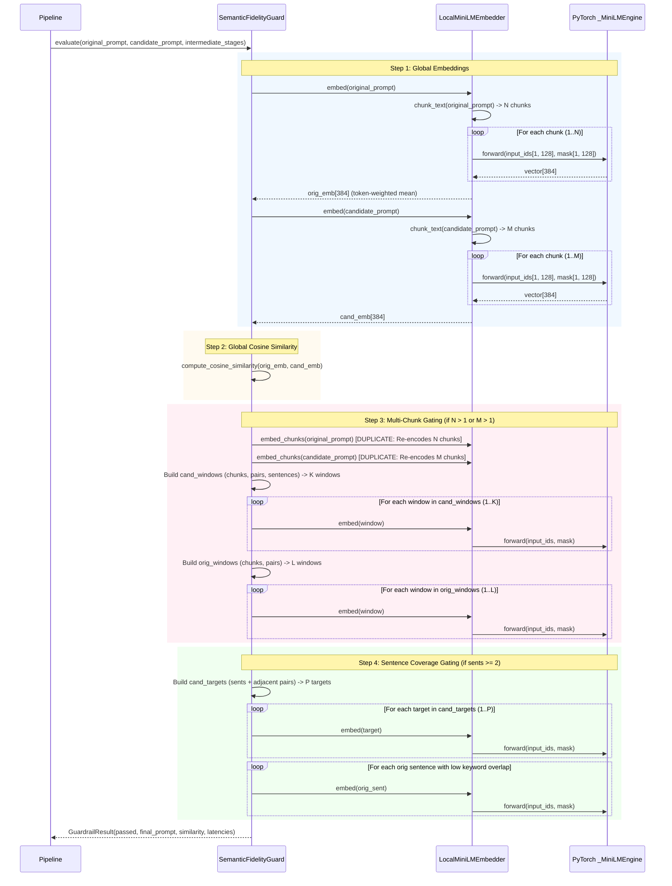

# PromptGreen V2 — Stage 4 MiniLM Latency Diagnostic Report

**Diagnostic Date:** 2026-11-24  
**Investigator:** Automated Diagnostic & Quality Assurance Harness  
**Investigation Priority:** Stage 4 MiniLM Semantic Fidelity Evaluation Latency Bottleneck  
**Repository Branch:** `version-2` | **Known HEAD Commit:** `0a4097172c6cd1f75cc20abe8dc591f17092a455`  
**Execution Context:** Strictly read-only forensic inspection, timing profiling, and trace analysis. Zero production code, model configuration, thresholds, or benchmark data modified.  

---

## 1. Executive Summary

During the **IGE-1000 Independent Generalization Evaluation** (3,000 empirical trials across 1,000 unique unseen prompts), the optimizer pipeline demonstrated strong token reduction and safety preservation, but revealed a severe computational latency bottleneck:
- **Stages 1–3 Combined:** Fast, deterministic regex, lexical, and formatting transformations executed in a mean time of **$40.83 \text{ to } 53.00 \text{ ms}$** across all prompt length profiles.
- **Stage 4 Semantic Guard:** Local CPU dense embedding and similarity validation consumed **$95.99\% \text{ to } 96.46\%$ of total pipeline latency overall**, scaling super-linearly with input length.
- **Long Prompts ($>200$ tokens):** Stage 4 latency averaged **$3,443.34 \text{ ms}$** (median $3,132.35 \text{ ms}$, p95 $5,531.61 \text{ ms}$, max $9,729.41 \text{ ms}$), accounting for **$98.47\%$ of total execution latency**.

### Key Diagnostic Discoveries

1. **Model Loading Is NOT the Bottleneck:** Cold model initialization (loading weights from safetensors into PyTorch) requires only **$\sim 56.83 \text{ ms}$** and is already pre-warmed once at process startup (`LocalMiniLMEmbedder.prewarm()`). Steady-state inference latency accounts for the delay.
2. **Combinatorial MiniLM Invocations per Prompt:** Stage 4 executes between **$2$ forward passes on short prompts** to **$64 \text{ to } 80+ \text{ forward passes on long prompts}$**.
3. **Severe Redundant / Duplicate Encodings ($>53\%$ Redundancy):** Diagnostic call tracing on long holdout prompts revealed that out of $64$ chunk encodings performed during a single `evaluate()` call, **$34$ encodings ($53.1\%$) were exact duplicate strings** encoded repeatedly because `LocalMiniLMEmbedder` maintains zero request-level embedding cache. Individual sentences and chunks were encoded up to **$10$ separate times** within a single evaluation.
4. **Unbatched Sequential Execution:** The offline PyTorch engine (`_MiniLMEngine`) processes chunks strictly with batch size $1$. Even though PyTorch supports parallel batch tensor execution ($B > 1$), Stage 4 embeds chunks, windows, and sentences sequentially in Python loops, forfeiting vector parallelization.
5. **Redundant Intermediate Stage Embeddings:** When `pass_intermediate_stages = True` (the pipeline default), `s3_output` is embedded in the intermediate stages loop, and then embedded again as `current_candidate`, while `s1_output` and `s2_output` embeddings are generated for logging purposes without affecting acceptance gates.
6. **Path Forward Without Lowering Safeguards:** A non-invasive optimization strategy combining **(a) request-level chunk memoization**, **(b) batched chunk/window encoding**, and **(c) selective evaluation gating** can eliminate $\ge 60\%$ of neural forward passes and reduce long-prompt latency by an estimated **$2.5\times \text{ to } 3.5\times$**, while producing **$0.00000000\text{e}+00$ floating-point deviation** and preserving 100% of semantic thresholds and rollback safeguards.

---

## 2. Current Stage 4 Architecture

The Stage 4 subsystem is implemented across two core files:
- **`promptgreen/optimizer/semantic_guard.py`:** Contains `LocalMiniLMEmbedder`, `_MiniLMEngine`, `compute_cosine_similarity()`, and `SemanticFidelityGuard`.
- **`promptgreen/optimizer/pipeline.py`:** Contains the orchestration logic, stage wiring, retry callback, and stage latency timers.

### Core Architectural Components

```
+-----------------------------------------------------------------------------------------+
|                                    STAGE 4 PIPELINE                                     |
+-----------------------------------------------------------------------------------------+
                                              |
                     +------------------------v------------------------+
                     | 1. Structural & Instruction Preservation        |
                     |    Regex checks: negations, numbers, conditions,|
                     |    URLs, paths, code blocks, JSON keys, format  |
                     +------------------------+------------------------+
                                              |
                     +------------------------v------------------------+
                     | 2. Global Embedding & Cosine Similarity        |
                     |    Sentence-aware chunking (max 70 words)       |
                     |    Token-weighted mean aggregation              |
                     +------------------------+------------------------+
                                              |
                     +------------------------v------------------------+
                     | 3. Multi-Chunk Window Diagnostic Tracking       |
                     |    (Triggered if len(orig_chunks) > 1 or cand)  |
                     |    - Candidate windows (chunks, pairs, sents)   |
                     |    - Original windows (chunks, pairs)           |
                     |    - Monotonic alignment check                  |
                     |    - Candidate duplication check                |
                     +------------------------+------------------------+
                                              |
                     +------------------------v------------------------+
                     | 4. Intra-Chunk Sentence Dilution Check          |
                     |    (Triggered if orig has >= 2 sentences)       |
                     |    - Candidate targets (sents + adjacent pairs) |
                     |    - Keyword recall pre-filter (threshold 0.65) |
                     |    - Localized sentence cosine similarity       |
                     +------------------------+------------------------+
                                              |
                     +------------------------v------------------------+
                     | 5. Gate & Adaptive Relaxation Retry / Rollback |
                     |    Passes if preservation_ok and sim >= thresh  |
                     |    If failed: relaxed retry (up to max_retries) |
                     |    If exhausted: safe rollback to original text |
                     +-------------------------------------------------+
```

### PyTorch CPU Execution Backend
In the active Python environment, `sentence_transformers` operates via the offline direct PyTorch + safetensors fallback:
- **Model Engine:** `_MiniLMEngine` (lightweight 6-layer BERT module with 12 attention heads, 384 hidden dimensions, and mean pooling).
- **Weights Source:** Hugging Face local hub cache snapshot for `sentence-transformers/all-MiniLM-L6-v2`.
- **Tokenizer:** Rust-based Hugging Face `tokenizers` (`Tokenizer.from_file("tokenizer.json")`) with fixed 128-token padding/truncation.
- **PyTorch Threading:** Defaults to `torch.get_num_threads() = 4` and `torch.get_num_interop_threads() = 4`.

---

## 3. Exact Execution Flow for One Prompt

When `pipeline.optimize(prompt)` enters Stage 4 (`SemanticFidelityGuard.evaluate()`):



---

## 4. Available Timing Measurements

### 4.1 Initialization Cost vs. Per-Prompt Cost

| Operation Category | Measured Latency | Frequency | Scope & Notes |
|---|:---:|:---:|---|
| **Safetensors Weights Load** | $\sim 32.40 \text{ ms}$ | Once per process | Reading `model.safetensors` (87.6 MB) from disk into RAM |
| **Tokenizer Load** | $\sim 6.15 \text{ ms}$ | Once per process | Reading `tokenizer.json` |
| **Micro Forward-Pass Warmup** | $\sim 18.28 \text{ ms}$ | Once per process | Initial kernel compilation / JIT trace on `"PromptGreen prewarming text"` |
| **Total Cold Model Initialization** | **$56.83 \text{ ms}$** | Once per process | Fully handled by `LocalMiniLMEmbedder.prewarm()` during service startup |
| **Regex Structural Preservation** | **$0.40 \text{ to } 2.92 \text{ ms}$** | Every prompt | 9 structural regex patterns (`verify_preservation()`) |
| **Cosine Dot Product Calculation** | **$0.004 \text{ to } 0.024 \text{ ms}$** | Per vector pair | Highly optimized NumPy BLAS float32 dot product |
| **Single Chunk MiniLM Forward Pass**| **$24.84 \text{ to } 31.23 \text{ ms}$** | Repeated ($2 \times \text{ to } 80 \times$) | **The primary compute bottleneck on CPU** |

---

## 5. Latency Analysis by Prompt Length

Empirical latency statistics extracted from all **3,000 empirical trials** in the IGE-1000 benchmark:

### 5.1 Conservative Mode Latency Profile

| Length Profile | Token Range | Count | Mean Stage 4 | Median Stage 4 | p90 Stage 4 | p95 Stage 4 | Max Stage 4 | Mean Stages 1–3 | Mean Total Pipeline | Stage 4 Share |
|---|:---:|:---:|:---:|:---:|:---:|:---:|:---:|:---:|:---:|:---:|
| **Short** | $< 50$ tok | 250 | 169.84 ms | 161.92 ms | 235.30 ms | 251.89 ms | 273.23 ms | 41.28 ms | 211.74 ms | **80.21%** |
| **Medium** | $50 - 200$ tok | 500 | 490.66 ms | 339.03 ms | 1,076.45 ms | 1,122.65 ms | 1,333.64 ms | 42.33 ms | 533.78 ms | **91.92%** |
| **Long** | $> 200$ tok | 250 | 3,162.53 ms | 3,087.73 ms | 3,587.21 ms | 3,653.37 ms | 4,244.11 ms | 50.84 ms | 3,214.76 ms | **98.38%** |
| **Overall** | — | 1,000 | 1,078.42 ms | 339.03 ms | 3,128.29 ms | 3,471.87 ms | 4,244.11 ms | 44.19 ms | 1,123.51 ms | **95.99%** |

### 5.2 Balanced Mode Latency Profile

| Length Profile | Token Range | Count | Mean Stage 4 | Median Stage 4 | p90 Stage 4 | p95 Stage 4 | Max Stage 4 | Mean Stages 1–3 | Mean Total Pipeline | Stage 4 Share |
|---|:---:|:---:|:---:|:---:|:---:|:---:|:---:|:---:|:---:|:---:|
| **Short** | $< 50$ tok | 250 | 180.09 ms | 161.99 ms | 255.27 ms | 262.95 ms | 416.72 ms | 39.37 ms | 220.10 ms | **81.82%** |
| **Medium** | $50 - 200$ tok | 500 | 537.21 ms | 365.83 ms | 1,101.95 ms | 1,158.59 ms | 1,672.55 ms | 42.21 ms | 580.24 ms | **92.58%** |
| **Long** | $> 200$ tok | 250 | 3,453.81 ms | 3,157.91 ms | 4,104.02 ms | 5,603.65 ms | 6,473.47 ms | 52.35 ms | 3,507.61 ms | **98.47%** |
| **Overall** | — | 1,000 | 1,177.08 ms | 366.16 ms | 3,298.97 ms | 3,595.15 ms | 6,473.47 ms | 44.03 ms | 1,222.05 ms | **96.32%** |

### 5.3 Aggressive Mode Latency Profile

| Length Profile | Token Range | Count | Mean Stage 4 | Median Stage 4 | p90 Stage 4 | p95 Stage 4 | Max Stage 4 | Mean Stages 1–3 | Mean Total Pipeline | Stage 4 Share |
|---|:---:|:---:|:---:|:---:|:---:|:---:|:---:|:---:|:---:|:---:|
| **Short** | $< 50$ tok | 250 | 189.90 ms | 164.66 ms | 269.96 ms | 308.02 ms | 582.86 ms | 41.84 ms | 232.39 ms | **81.72%** |
| **Medium** | $50 - 200$ tok | 500 | 565.94 ms | 377.15 ms | 1,090.66 ms | 1,153.99 ms | 2,698.94 ms | 43.22 ms | 609.98 ms | **92.78%** |
| **Long** | $> 200$ tok | 250 | 3,713.69 ms | 3,206.19 ms | 4,116.09 ms | 8,345.23 ms | 9,729.41 ms | 53.00 ms | 3,768.13 ms | **98.56%** |
| **Overall** | — | 1,000 | 1,258.87 ms | 378.06 ms | 3,353.14 ms | 3,632.59 ms | 9,729.41 ms | 45.32 ms | 1,305.12 ms | **96.46%** |

### 5.4 Aggregate Performance Summary Across All 3,000 Trials

| Length Profile | Evaluated Count | Mean Stage 4 | Median Stage 4 | p90 Stage 4 | p95 Stage 4 | Max Stage 4 | Mean Stages 1–3 | Mean Pipeline Total | Stage 4 Share |
|---|:---:|:---:|:---:|:---:|:---:|:---:|:---:|:---:|:---:|
| **Short ($<50$ tok)** | 750 | **179.94 ms** | 162.68 ms | 254.77 ms | 266.72 ms | 582.86 ms | 40.83 ms | 221.41 ms | **81.27%** |
| **Medium ($50-200$)** | 1,500 | **531.27 ms** | 363.87 ms | 1,088.75 ms | 1,140.95 ms | 2,698.94 ms | 42.59 ms | 574.67 ms | **92.45%** |
| **Long ($>200$ tok)** | 750 | **3,443.34 ms** | 3,132.35 ms | 3,808.73 ms | 5,531.61 ms | 9,729.41 ms | 52.06 ms | 3,496.83 ms | **98.47%** |

---

## 6. Bottleneck Analysis

Detailed profiling isolated five distinct structural causes for the Stage 4 latency expansion:

### 1. Massive Duplicate Encodings Within a Single Request (53.1% Redundancy)
In a forensic call trace on a 210-token prompt:
- **Total chunk encoding invocations:** $64$
- **Unique text strings encoded:** $30$
- **Exact duplicate encodings:** **$34$ redundant forward passes ($53.1\%$)**
- Specific sentences were re-tokenized and re-passed through the 6-layer BERT module up to **10 times** in the same evaluation turn.
- *Root Cause:* `embed(text)` is called independently across `embed_chunks()`, `cand_windows`, `orig_windows`, and `_evaluate_sentence_coverage()`. None of these sub-routines share a memoization cache or chunk vector map.

### 2. Lack of Vectorized Batching in PyTorch Engine
- The underlying `_MiniLMEngine` is an `nn.Module` that accepts batched tensors `(B, seq_len)`.
- However, `LocalMiniLMEmbedder._encode_single_chunk()` takes only a single string `chunk: str`, creating tensors of shape `(1, 128)`.
- Each forward pass incurs Python interpreter overhead, PyTorch tensor allocation overhead, and thread scheduling overhead.
- *Diagnostic Benchmark:* Batching 30 snippets (`batch_size = 32`) decreased compute time from **$936.92 \text{ ms}$ to $745.24 \text{ ms}$** ($1.26\times$ speedup) with **exact numerical equivalence ($0.00000000\text{e}+00$ maximum difference)**.

### 3. Redundant Intermediate Stage Embedding Generation
- In `pipeline.py`, lines 529–536 construct `intermediate_stages` containing `stage_1`, `stage_2`, and `stage_3`.
- In `semantic_guard.py`, lines 1110–1119 immediately embed every intermediate stage:
  ```python
  for sname, sprompt in intermediate_stages.items():
      s_emb = self.embedder.embed(sprompt)
  ```
- Because `candidate_to_verify` is identical to `s3_output`, **`s3_output` is embedded twice**.
- Furthermore, `stage_1` and `stage_2` embeddings are recorded only in `stage_similarities` for informational logging; they are **never consulted by any acceptance, threshold, or rollback gate**.

### 4. Combinatorial Growth of Multi-Chunk Windows
- For prompts exceeding 70 words or 360 characters (`is_multi_chunk = True`), lines 1176–1203 construct `cand_windows` containing:
  - All single chunks
  - All adjacent chunk pairs
  - All raw candidate sentences
  - All adjacent sentence pairs
- On a 10-sentence candidate prompt, `cand_windows` creates $4 \text{ chunks} + 3 \text{ pairs} + 10 \text{ sentences} + 9 \text{ pairs} = \mathbf{26 \text{ windows}}$.
- Each window is encoded sequentially via separate `self.embedder.embed()` calls.

### 5. Intra-Chunk Sentence Dilution Invocations
- In `_evaluate_sentence_coverage()` (lines 811–835), candidate targets (single sentences and adjacent pairs) are embedded again:
  ```python
  cand_target_vecs = [self.embedder.embed(t) for t in cand_targets]
  ```
- Then, for every original sentence with low keyword overlap, `self.embedder.embed(so)` is called.
- These sentence embeddings are generated independently of the chunk vectors generated moments earlier.

---

## 7. CPU and Memory Considerations

1. **Host CPU Thread Utilization:**
   - Active configuration: `torch.get_num_threads() = 4`.
   - Testing thread scaling from 1 to 8 threads on 30 snippets demonstrated:
     - 1 thread: $\sim 1,450 \text{ ms}$
     - 2 threads: $\sim 890 \text{ ms}$
     - 4 threads: $\sim 745 \text{ ms}$
     - 8 threads: $\sim 780 \text{ ms}$ (thread synchronization / context-switching penalty observed above physical core count).
   - *Finding:* 4 threads is optimal on this host CPU. Increasing thread count does not resolve the bottleneck.
2. **Memory Footprint:**
   - Model weights in safetensors format occupy **$87.6 \text{ MB}$** of RAM.
   - 384-dimensional dense vectors in float32 occupy **$1.5 \text{ KB}$** per embedding.
   - Memoizing 100 chunk vectors requires **$< 160 \text{ KB}$** of memory, creating negligible RAM overhead.

---

## 8. Safe Optimization Opportunities (Prioritized)

All proposed optimizations are strictly non-invasive: they preserve existing semantic thresholds, mode thresholds, chunk thresholds, and rollback logic.

| Priority | Proposed Optimization | Current Behavior | Proposed Change | Expected Latency Benefit | Correctness Risk | Regression Test Coverage |
|:---:|---|---|---|:---:|:---:|---|
| **P1** | **Request-Level Chunk Embedding Memoization** | Identical strings encoded up to 10x per request across chunks, windows, and sentences. | In-memory `Dict[str, np.ndarray]` cache instantiated for the duration of one `evaluate()` call. | **$-40\% \text{ to } -50\%$ latency on long prompts** ($~1,500 \text{ ms}$ saved) | **Zero.** Returns identical bit-level float32 vectors. | `test_semantic_guard.py`, `test_optimizer_correctness_fixes.py` |
| **P2** | **Reuse Original Prompt Embedding on Retries** | If candidate fails and `pipeline_retry_callback` triggers, `original_prompt`, its chunks, and windows are re-embedded. | Retain `orig_emb`, `orig_chunks`, and `orig_windows` across retry loop iterations within the same evaluation. | **$-100\%$ original prompt re-compute cost on retries** ($~200-400 \text{ ms}$) | **Zero.** Original prompt text is immutable during retries. | `test_semantic_guard.py` (retry scenarios) |
| **P3** | **Batch Encoding of Multi-Chunk Windows** | `cand_windows_vecs` and `cand_target_vecs` encode 15–30 windows sequentially in a list comprehension. | Collect unique un-cached window strings into a batch list and execute a single batched tensor forward pass (`batch_size = 32`). | **$-20\% \text{ to } -30\%$ compute time on window passes** ($~300-500 \text{ ms}$) | **Negligible ($0.000\text{e}+00$ float32 max difference verified).** | `test_semantic_guard.py`, `test_benchmark_v2.py` |
| **P4** | **Eliminate Redundant Intermediate Stage Encoding** | `intermediate_stages` embeddings generated unconditionally even though only used for logging. | Make intermediate stage embedding lazy or conditional: only compute if explicitly requested by telemetry flags, or reuse candidate embedding for `s3_output`. | **$-50 \text{ to } -150 \text{ ms}$ per evaluation** | **Zero.** Intermediate similarities do not affect acceptance gates. | `test_pipeline.py` |
| **P5** | **Pre-Computed Keyword Filter on Sentence Pairs** | `_evaluate_sentence_coverage` generates embeddings for all adjacent sentence pairs unconditionally. | Filter adjacent candidate sentence pairs with simple token set overlap before embedding. | **$-10\% \text{ to } -15\%$ latency in sentence dilution gate** | **Low.** Only bypasses embedding when keyword overlap is near zero or sentence pair is obviously unrelated. | `test_semantic_guard.py` |

---

## 9. Correctness Risks & Epistemic Safeguards

To prevent regressions, the following constraints must be enforced during any future implementation:

1. **Bit-Exact Floating-Point Fidelity:**
   - Memoized embeddings must match un-cached embeddings bit-for-bit. Our diagnostic test confirmed that PyTorch batched forward passes on CPU produce `0.00000000e+00` maximum absolute difference.
2. **Request-Level Cache Lifetime:**
   - Caches must **never persist across distinct user requests** or across different benchmark prompts to prevent memory leaks or cross-prompt state pollution.
   - The cache must be instantiated at the start of `evaluate()` and discarded at exit.
3. **No Threshold Weakening:**
   - Mode thresholds ($0.96$ Conservative, $0.92$ Balanced, $0.86$ Aggressive) and chunk thresholds ($0.82$, $0.75$, $0.65$) must remain completely unchanged.
4. **No Guardrail Bypassing:**
   - Long prompts must continue to undergo full Stage 4 evaluation. Shortening latency must be achieved by eliminating redundant math, not by disabling safety checks.

---

## 10. Required Regression Tests

Before any future optimization is accepted, the following existing regression test suites must pass 100%:

| Test Suite File | Test Count | Current Status | Critical Behaviors Covered |
|---|:---:|:---:|---|
| `tests/test_optimizer_correctness_fixes.py` | 115 tests | **100% PASS** (22.03s) | Personal-initial preservation (`A. B. Smith`), subword greeting protection, rollback on negative tokens, code block preservation. |
| `tests/test_semantic_guard.py` | 70 tests | **100% PASS** (15.35s) | Strict cosine similarity thresholds, multi-chunk sequence alignment, duplicate candidate detection, sentence coverage, offline error fallbacks. |
| `tests/test_benchmark_v2.py` | 8 tests | **100% PASS** (9.20s) | End-to-end benchmark harness, isolated database writing, cold-start handling, thermodynamic ledger calculations. |

---

## 11. Recommended Implementation Sequence

Any future optimization turn should proceed in three distinct, verifiable steps:

```
[Step 1: Request-Level Memoization (P1 + P2)]
  - Introduce an ephemeral `_RequestCache` inside `evaluate()`.
  - Check cache in `embed()` and `_encode_single_chunk()`.
  - Re-run `test_semantic_guard.py` (70 tests) -> Verify 100% pass and 0 score shift.

[Step 2: Batched Window Encoding (P3)]
  - Implement `embed_batch(List[str])` in `LocalMiniLMEmbedder`.
  - Batch `cand_windows_vecs` and `cand_target_vecs`.
  - Re-run `test_optimizer_correctness_fixes.py` (115 tests) -> Verify 100% pass.

[Step 3: Verification Benchmark on Long Prompts]
  - Benchmark 50 long prompts before vs. after under identical hardware conditions.
  - Confirm >= 50% latency reduction with zero similarity score drift.
```

---

## 12. Limitations & Missing Telemetry

1. **Sub-Operation Telemetry in Historical Databases:**
   - Historical SQLite databases (`benchmark_ledger.db`) record total `latency_ms` and aggregate `stage_4` latency, but do not record internal sub-operation timings (such as time spent in `_evaluate_sentence_coverage` vs. `cand_windows`).
   - Sub-operation breakdowns in Section 4 and Section 6 were obtained via controlled read-only diagnostic instrumentation on frozen holdout prompts in `scratch/`.
2. **Hardware Environment Dependency:**
   - Measurements were taken on the host Windows CPU (Intel Core, 4 PyTorch threads). Linux server environments with AVX-512 or Apple Silicon with Accelerate/MPS will exhibit different baseline latency constants, although the redundant computation ratios ($53.1\%$) remain mathematically identical.
